# End-to-End LLM-Wiki Iteration Architecture

> For internal tool execution logic, database table interactions, and exact SQL statements, see the [MCP Tools Reference](file:///C:/Users/ASUS/Documents/llm-wiki/docs/mcp_tools.md).

This document outlines the high-level architecture of the autonomous textbook iteration loop. Tool calls are treated as clean service boundaries—internal database queries, full-text index rebuilds, and AST file manipulation are encapsulated entirely inside the MCP server.

### System Workflow Overview
1. **Web Harvesting (`deep-web-analysis`):** Multi-platform discovery across Reddit, Twitter/X, Hacker News, GitHub, Lobsters, ArXiv, etc.
2. **Adversarial Curation & Ingestion (`filtering-raw-dump`):** Non-deterministic 4-point relevance filtering followed by atomic deduplication and storage in `raw_firehose` via `llm_wiki_firehose_ingest`.
3. **Textbook Reading & Placement (`wiki-reader`):** Groups vetted items by architectural topic, deconstructs prompt into dual semantic and keyword searches (`llm_wiki_search_similarity` & `llm_wiki_search_keyword`), filters noise, retrieves existing chapter sections via `llm_wiki_read_section` with zero token bloat, and determines where new knowledge belongs.
4. **Surgical Patching, Cross-Linking & Atomic Push (`ast-markdown-patcher`):** Slices section on disk (`llm_wiki_patch_section`), discovers candidate cross-links for the new content (`llm_wiki_suggest_links`), vets candidates against the 4-Point Epistemic Link Audit, splices verified `[[wikilinks]]`, and pushes atomically to GitHub (`llm_wiki_git_commit_and_push`).
5. **LLM-Council Deep Reasoning (`data-point-reasoning`):** Two-phase deliberation (Raw Data Council followed by Adversarial Review Council) across newly indexed records to extract enduring architectural invariants into the cycle digest.
6. **Query Steering & Gap Traversal (`iterative-query-gen` & `first-principle-reasoning`):** Supplies `parent_prompt` to `wiki-reader`, runs first-principles gap reasoning on vetted findings, and synthesizes platform-tailored manifests across Reddit, Hacker News, GitHub, Twitter/X, Lobsters, ArXiv, Stack Overflow, and Hugging Face.

---

```mermaid
flowchart TD
    %% ==========================================
    %% STAGE 1: WEB RESEARCH & HARVESTING
    %% ==========================================
    subgraph S1 ["Stage 1: Web Research & Harvesting"]
        Trigger["User Request / Scheduled Timer / Backlog"] --> SkillDWA["Skill: deep-web-analysis"]
        SkillDWA -->|"Scrapes multi-platform feeds"| RawJSON["harvested_candidates.json (Raw Web Posts)"]
    end

    %% ==========================================
    %% STAGE 2: ADVERSARIAL CURATION & INGESTION
    %% ==========================================
    subgraph S2 ["Stage 2: Adversarial Curation & Ingestion (filtering-raw-dump)"]
        RawJSON --> SkillFRD["Skill: filtering-raw-dump"]
        SkillFRD -->|"Applies 4-Point Filter & Tool Call: llm_wiki_firehose_ingest(approved)"| ToolIngest["MCP Tool: llm_wiki_firehose_ingest"]
        ToolIngest -->|"Returns: Ingested count, duplicates skipped"| IngestedClean["Clean Batch Stored in Central DB (raw_firehose)"]
    end

    %% ==========================================
    %% STAGE 3: TEXTBOOK READING & SYNTHESIS
    %% ==========================================
    subgraph S3 ["Stage 3: Read Existing Textbook (wiki-reader)"]
        IngestedClean --> SkillReader["Skill: wiki-reader (Groups by Topic)"]
        SkillReader -->|"Branch 1: llm_wiki_search_similarity(query)"| ToolSim["MCP Tool: llm_wiki_search_similarity"]
        SkillReader -->|"Branch 2: llm_wiki_search_keyword(keywords)"| ToolKey["MCP Tool: llm_wiki_search_keyword"]
        ToolSim --> MatchList["Filter Noise & Identify Target Sections"]
        ToolKey --> MatchList
        
        MatchList -->|"Tool Call: llm_wiki_read_section(file, heading)"| ToolRead["MCP Tool: llm_wiki_read_section"]
        ToolRead -->|"Returns: Exact section markdown (Zero token bloat)"| SectionText["Existing Section Text"]
        SectionText --> AgentSynthesize["Synthesize Cohesive Section Update"]
    end

    %% ==========================================
    %% STAGE 4: SURGICAL FILE PATCH & CROSS-LINKING
    %% ==========================================
    subgraph S4 ["Stage 4: Surgical Section Patching & Cross-Linking (ast-markdown-patcher)"]
        AgentSynthesize --> SkillPatch["Skill: ast-markdown-patcher"]
        
        SkillPatch -->|"Step 1: llm_wiki_patch_section(file, heading, content)"| ToolPatch1["MCP Tool: llm_wiki_patch_section"]
        ToolPatch1 -->|"Spliced & indexed on disk"| SplicedDraft["Section Spliced in Chapter"]
        
        SplicedDraft -->|"Step 2: llm_wiki_suggest_links(file, heading)"| ToolSuggest["MCP Tool: llm_wiki_suggest_links"]
        ToolSuggest -->|"Candidate pairs"| EpistemicAudit["4-Point Epistemic Link Audit (Vets Candidates)"]
        
        EpistemicAudit -->|"Step 3: Splice verified [[wikilinks]]"| ToolPatch2["MCP Tool: llm_wiki_patch_section"]
        ToolPatch2 --> PatchedChapter["Verified Chapters on Disk (wiki/*.md)"]
        
        PatchedChapter -->|"Step 4: Atomic Remote Push"| ToolGit["MCP Tool: llm_wiki_git_commit_and_push"]
        ToolGit --> RemoteRepo["GitHub Remote Tracking Branch"]
    end

    %% ==========================================
    %% STAGE 5: DATA-POINT REASONING (LLM-COUNCIL)
    %% ==========================================
    subgraph S5 ["Stage 5: Data-Point Reasoning (LLM-Council)"]
        RemoteRepo --> SkillDPR["Skill: data-point-reasoning"]
        
        subgraph Phase1 ["Phase 1: Raw Data Council"]
            SkillDPR -->|"invoke_subagent (Parallel Fleet)"| SubAgents["Sub-Agent Fleet (Reasoning on Every Item)"]
            SubAgents -->|"Synthesizes individual findings"| InitialSynth["Initial Synthesis (V1 Draft)"]
        end
        
        subgraph Phase2 ["Phase 2: Adversarial Review Council"]
            InitialSynth -->|"invoke_subagent (Specialist Personas)"| ReviewCouncil["Review Council (Adversarial Critique)"]
            ReviewCouncil -->|"Hardens facts & discards hype"| HardenedFacts["Hardened Truth & Architectural Invariants"]
        end
    end

    %% ==========================================
    %% STAGE 6: DYNAMIC QUERY STEERING & REASONING
    %% ==========================================
    subgraph S6 ["Stage 6: Dynamic Query Steering & Reasoning (iterative-query-gen)"]
        HardenedFacts --> InputsIQG["Inputs from deep-web-analysis:<br/>• parent_prompt<br/>• manifest_path (Required)"]
        
        InputsIQG --> SkillReaderIQG["Skill: wiki-reader<br/>(Supply: parent_prompt)"]
        
        SkillReaderIQG -->|"Returns: direct_findings & linked_findings"| Step5Gaps["Skill: first-principle-reasoning<br/>(Critiques findings, surfaces missing numbers & failure modes)"]
        
        Step5Gaps --> Step6Dialects["Step 3: Multi-Platform Dialect Synthesis<br/>(Reddit, HN, Lobsters, GitHub, Twitter, ArXiv, SO, HF)"]
        
        Step6Dialects --> Manifest["Write Platform-Tailored query_manifest.json<br/>(Directly to required manifest_path)"]
        Manifest -->|"Feeds next harvesting iteration"| SkillDWA
    end

    %% Styling
    classDef skill fill:#2d3748,stroke:#4a5568,color:#fff,stroke-width:2px;
    classDef mcp fill:#4c51bf,stroke:#667eea,color:#fff,stroke-width:2px;
    classDef data fill:#276749,stroke:#38a169,color:#fff,stroke-width:2px;
    classDef council fill:#553c9a,stroke:#805ad5,color:#fff,stroke-width:2px;
    classDef steer fill:#744210,stroke:#d69e2e,color:#fff,stroke-width:2px;

    class SkillDWA,SkillFRD,SkillDPR,SkillReader,SkillPatch,SkillReaderIQG,Step5Gaps skill;
    class ToolIngest,ToolSim,ToolKey,ToolRead,ToolPatch1,ToolSuggest,ToolPatch2,ToolGit mcp;
    class RawJSON,IngestedClean,SplicedDraft,PatchedChapter,RemoteRepo,Manifest data;
    class SubAgents,ReviewCouncil,InitialSynth,HardenedFacts,EpistemicAudit council;
    class InputsIQG,Step6Dialects steer;
```

