# End-to-End LLM-Wiki Iteration Architecture

> For internal tool execution logic, database table interactions, and exact SQL statements, see the [MCP Tools Reference](file:///C:/Users/ASUS/Documents/llm-wiki/docs/mcp_tools.md).

This document outlines the high-level architecture of the autonomous textbook iteration loop. Tool calls are treated as clean service boundaries—internal database queries, full-text index rebuilds, and AST file manipulation are encapsulated entirely inside the MCP server.

### System Workflow Overview
1. **Web Harvesting (`deep-web-analysis`):** Multi-platform discovery across Reddit, Twitter/X, and GitHub.
2. **Post Deduplication & Storage (`llm_wiki_firehose_ingest`):** Atomic ingestion of unique posts.
3. **LLM-Council Deep Reasoning (`data-point-reasoning`):** Two-phase deliberation (Raw Data Council followed by Adversarial Review Council).
4. **Targeted Textbook Reading (`wiki-reader`):** Sub-15ms lexical and semantic lookup, followed by surgical section extraction with zero token bloat.
5. **Surgical Patching (`ast-markdown-patcher`):** Single-section updates, automatic cross-chapter wikilinking, and index synchronization.
6. **Remote Version Control (`git-pr-arbiter`):** Atomic Git staging, commit creation, and remote push.
7. **Query Steering & Gap Traversal (`iterative-query-gen` & `first-principle-reasoning`):** Dual-track decomposition, cross-link destination audit, first-principles gap formulation, and multi-platform manifest synthesis across Reddit, Hacker News, GitHub, Twitter/X, Lobsters, ArXiv, Stack Overflow, and Hugging Face.

---

```mermaid
flowchart TD
    %% ==========================================
    %% STAGE 1: WEB RESEARCH & HARVESTING
    %% ==========================================
    subgraph S1 ["Stage 1: Web Research & Harvesting"]
        Trigger["User Request / Scheduled Timer / Backlog"] --> SkillDWA["Skill: deep-web-analysis"]
        SkillDWA -->|"Scrapes Reddit, Twitter/X, GitHub"| RawJSON["harvested_candidates.json (Raw Web Posts)"]
    end

    %% ==========================================
    %% STAGE 2: DEDUPLICATION & INGESTION (MCP)
    %% ==========================================
    subgraph S2 ["Stage 2: Post Deduplication & Storage"]
        RawJSON -->|"Tool Call: llm_wiki_firehose_ingest(items)"| ToolIngest["MCP Tool: llm_wiki_firehose_ingest"]
        ToolIngest -->|"Returns: Ingested count, duplicates skipped"| IngestedClean["Clean Batch Stored in Central DB"]
    end

    %% ==========================================
    %% STAGE 3: DATA-POINT REASONING (LLM-COUNCIL)
    %% ==========================================
    subgraph S3 ["Stage 3: Data-Point Reasoning (LLM-Council)"]
        IngestedClean --> SkillDPR["Skill: data-point-reasoning"]
        SkillDPR -->|"Partitions raw posts into atomic items"| ChunkPartition["Item Partitioning Engine"]
        
        subgraph Phase1 ["Phase 1: Raw Data Council"]
            ChunkPartition -->|"invoke_subagent (Parallel Fleet)"| SubAgents["Sub-Agent Fleet (Reasoning on Every Item)"]
            SubAgents -->|"Synthesizes individual findings"| InitialSynth["Initial Synthesis (V1 Draft)"]
        end
        
        subgraph Phase2 ["Phase 2: Adversarial Review Council"]
            InitialSynth -->|"invoke_subagent (Specialist Personas)"| ReviewCouncil["Review Council (Adversarial Critique)"]
            ReviewCouncil -->|"Hardens facts & discards hype"| HardenedFacts["Hardened Truth & Architectural Invariants"]
        end
    end

    %% ==========================================
    %% STAGE 4: CHECK EXISTING TEXTBOOK (ZERO BLOAT)
    %% ==========================================
    subgraph S4 ["Stage 4: Read Existing Textbook"]
        HardenedFacts --> SkillReader["Skill: wiki-reader"]
        SkillReader -->|"Tool Call: llm_wiki_search_hybrid(query)"| ToolSearch["MCP Tool: llm_wiki_search_hybrid"]
        ToolSearch -->|"Returns: Ranked matching sections"| MatchList["Target Chapter & Heading Identified"]
        
        MatchList -->|"Tool Call: llm_wiki_read_section(file, heading)"| ToolRead["MCP Tool: llm_wiki_read_section"]
        ToolRead -->|"Returns: Exact section markdown (Zero token bloat)"| SectionText["Existing Section Text"]
        SectionText --> AgentCompare["Agent Compares Existing Text vs New Facts"]
    end

    %% ==========================================
    %% STAGE 5: SURGICAL FILE PATCH & RE-INDEXING
    %% ==========================================
    subgraph S5 ["Stage 5: Surgical Section Patching"]
        AgentCompare --> SkillPatch["Skill: ast-markdown-patcher"]
        SkillPatch -->|"Tool Call: llm_wiki_patch_section(file, heading, content)"| ToolPatch["MCP Tool: llm_wiki_patch_section"]
        ToolPatch -->|"Returns: Spliced cleanly, cross-links created, search updated"| PatchedChapter["Chapter Updated on Disk (wiki/*.md)"]
    end

    %% ==========================================
    %% STAGE 6: REMOTE VERSION CONTROL
    %% ==========================================
    subgraph S6 ["Stage 6: Version Control & Remote Sync"]
        PatchedChapter --> SkillPR["Skill: git-pr-arbiter"]
        SkillPR -->|"Tool Call: llm_wiki_git_commit_and_push(file, message)"| ToolGit["MCP Tool: llm_wiki_git_commit_and_push"]
        ToolGit -->|"Returns: Staged, committed, and pushed"| RemoteRepo["GitHub Remote Tracking Branch"]
    end

    %% ==========================================
    %% STAGE 7: DYNAMIC QUERY STEERING & REASONING
    %% ==========================================
    subgraph S7 ["Stage 7: Dynamic Query Steering & Reasoning (iterative-query-gen)"]
        RemoteRepo --> InputsIQG["Inputs from deep-web-analysis:<br/>• parent_prompt<br/>• manifest_path (Required)"]
        
        %% Dual-track retrieval
        InputsIQG --> Branch1["Branch 1: Semantic Prompts<br/>(2–4 short 6-word conceptual sub-prompts)"]
        InputsIQG --> Branch2["Branch 2: Technical Terms<br/>(Key technical nouns, acronyms, flags)"]
        
        Branch1 -->|"Tool Call (limit=25 per prompt)"| ToolSim["MCP Tool: llm_wiki_search_similarity"]
        Branch2 -->|"Tool Call (limit=25 per term set)"| ToolKW["MCP Tool: llm_wiki_search_keyword"]
        
        ToolSim --> CandidateSections["Compile Candidate Sections"]
        ToolKW --> CandidateSections
        
        CandidateSections --> Step3Filter["Step 3: Garbage Removal & Relevance Filter<br/>(Discard superficial similarity hits & generic boilerplate)"]
        
        Step3Filter --> Step4Audit["Step 4: Cross-Link & Destination Audit<br/>(Check wiki_links via llm_wiki_get_graph,<br/>read destination content via llm_wiki_read_section)"]
        
        Step4Audit --> Step5Gaps["Step 5: Gap Reasoning via /first-principle-reasoning<br/>(Critiques findings, surfaces missing numbers & failure modes)"]
        
        Step5Gaps --> Step6Dialects["Step 6: Multi-Platform Dialect Synthesis<br/>(Reddit, HN, Lobsters, GitHub, Twitter, ArXiv, SO, HF)"]
        
        Step6Dialects --> Manifest["Write Platform-Tailored query_manifest.json<br/>(Directly to required manifest_path)"]
        Manifest -->|"Feeds next harvesting iteration"| SkillDWA
    end

    %% Styling
    classDef skill fill:#2d3748,stroke:#4a5568,color:#fff,stroke-width:2px;
    classDef mcp fill:#4c51bf,stroke:#667eea,color:#fff,stroke-width:2px;
    classDef data fill:#276749,stroke:#38a169,color:#fff,stroke-width:2px;
    classDef council fill:#553c9a,stroke:#805ad5,color:#fff,stroke-width:2px;
    classDef steer fill:#744210,stroke:#d69e2e,color:#fff,stroke-width:2px;

    class SkillDWA,SkillDPR,SkillReader,SkillPatch,SkillPR skill;
    class ToolIngest,ToolSearch,ToolRead,ToolPatch,ToolGit,ToolKW,ToolSim mcp;
    class RawJSON,IngestedClean,PatchedChapter,RemoteRepo,Manifest data;
    class SubAgents,ReviewCouncil,InitialSynth,HardenedFacts,ChunkPartition council;
    class InputsIQG,Branch1,Branch2,CandidateSections,Step3Filter,Step4Audit,Step5Gaps,Step6Dialects steer;
```

