# LLM-Wiki MCP Server: Complete Tool Reference & Manual

This document provides a complete reference for all tools exposed by the **LLM-Wiki MCP Server** ([`servers/llm_wiki_mcp.py`](file:///C:/Users/ASUS/Documents/llm-wiki/servers/llm_wiki_mcp.py)).

---

## 1. Overview & Architecture

The LLM-Wiki MCP Server is a local, lightweight tool bridge. It allows AI coding assistants (such as Claude Desktop, Antigravity, or Cursor) to communicate directly with the LLM-Wiki textbook and its central SQLite database ([`raw_firehose.db`](file:///C:/Users/ASUS/Documents/llm-wiki/raw_firehose.db)).

### Key Design Principles

1. **Standard Input/Output (stdio) Communication:**
   The server communicates using JSON-RPC 2.0 messages over standard input (`stdin`) and standard output (`stdout`). Log messages are strictly written to standard error (`stderr`) or a log file ([`logs/mcp_server.log`](file:///C:/Users/ASUS/Documents/llm-wiki/logs/mcp_server.log)) to avoid corrupting tool data.
2. **Zero-Daemon Architecture:**
   There is no background HTTP server or port to keep open. The server starts when needed and accesses SQLite directly using Write-Ahead Logging (WAL) for safe, concurrent reads and writes.
3. **Surgical Precision (Zero Token Bloat):**
   Tools read and write individual sections of markdown chapters instead of entire multi-megabyte files. This saves context tokens and prevents context window exhaustion.
4. **Automatic Cross-Chapter Linking:**
   When editing sections, the server automatically detects mentions of topics from other chapters and converts them into `[[chapter/topic|text]]` wikilinks, keeping the textbook interconnected.

---

## 2. Server Setup & Configuration

### Starting the Server Manually
To verify the server is working, run it directly from your terminal:
```bash
python servers/llm_wiki_mcp.py
```
Send a newline-terminated JSON-RPC message on `stdin` to test:
```json
{"jsonrpc": "2.0", "id": 1, "method": "tools/list", "params": {}}
```
The server will print the JSON response to `stdout`.

### MCP Client Configuration

Add the server to your MCP configuration file (e.g. `claude_desktop_config.json` or `antigravity.json`):

```json
{
  "mcpServers": {
    "llm-wiki": {
      "command": "python",
      "args": [
        "C:\\Users\\ASUS\\Documents\\llm-wiki\\servers\\llm_wiki_mcp.py"
      ],
      "env": {
        "PYTHONIOENCODING": "utf-8"
      }
    }
  }
}
```

---

## 3. Quick Reference: All 12 Tools

| Canonical Name | Short Alias | Primary Purpose | Modifies Disk/DB? | Typical Latency |
| :--- | :--- | :--- | :---: | :---: |
| [`llm_wiki_firehose_ingest`](#1-llm_wiki_firehose_ingest) | `firehose_ingest` | Saves raw web posts with duplicate filtering | Yes (DB) | 10–50 ms |
| [`llm_wiki_firehose_query`](#2-llm_wiki_firehose_query) | `firehose_query` | Word search over raw Reddit/Twitter/GitHub posts | No | 2–5 ms |
| [`llm_wiki_search_hybrid`](#3-llm_wiki_search_hybrid) | `search_hybrid` | Blends exact word search and meaning search over textbook | No | 30–80 ms |
| [`llm_wiki_search_keyword`](#4-llm_wiki_search_keyword) | `search_keyword` | Pure FTS5 BM25 search with stopword filtering | No | 2–8 ms |
| [`llm_wiki_search_similarity`](#5-llm_wiki_search_similarity) | `search_similarity` | Pure fastembed vector cosine similarity search | No | 20–60 ms |
| [`llm_wiki_read_section`](#6-llm_wiki_read_section) | `read_section` | Reads only one section under a markdown heading | No | 1–3 ms |
| [`llm_wiki_patch_section`](#7-llm_wiki_patch_section) | `patch_section` | Updates one section, adds cross-links, updates search | Yes (File + DB) | 40–120 ms |
| [`llm_wiki_get_graph`](#8-llm_wiki_get_graph) | `get_graph` | Inspects backlinks, related topics, and missing topics | No | 2–8 ms |
| [`llm_wiki_suggest_links`](#9-llm_wiki_suggest_links) | `suggest_links` | Finds related sections across different chapters | No | 150–250 ms |
| [`llm_wiki_scan_links`](#10-llm_wiki_scan_links) | `scan_links` | Scans chapter text and adds cross-chapter wikilinks | Optional (File + DB) | 50–150 ms |
| [`llm_wiki_git_commit_and_push`](#11-llm_wiki_git_commit_and_push) | `git_commit_and_push` | Stages, commits, and pushes changes to GitHub | Yes (Git repo) | 1000–3000 ms |
| [`llm_wiki_reindex`](#12-llm_wiki_reindex) | `reindex` | Synchronizes shadow tables, FTS5, and link graph from markdown | Yes (DB) | 150–300 ms |

---

## 4. Detailed Tool Reference

---

### 1. `llm_wiki_firehose_ingest`
*Alias: `firehose_ingest`*

#### Purpose
Ingests raw scraped posts from external platforms (Reddit, Twitter/X, GitHub) into the central database table (`raw_firehose`) with automatic URL/ID deduplication and full-text index updates.

#### Architecture & Workflow
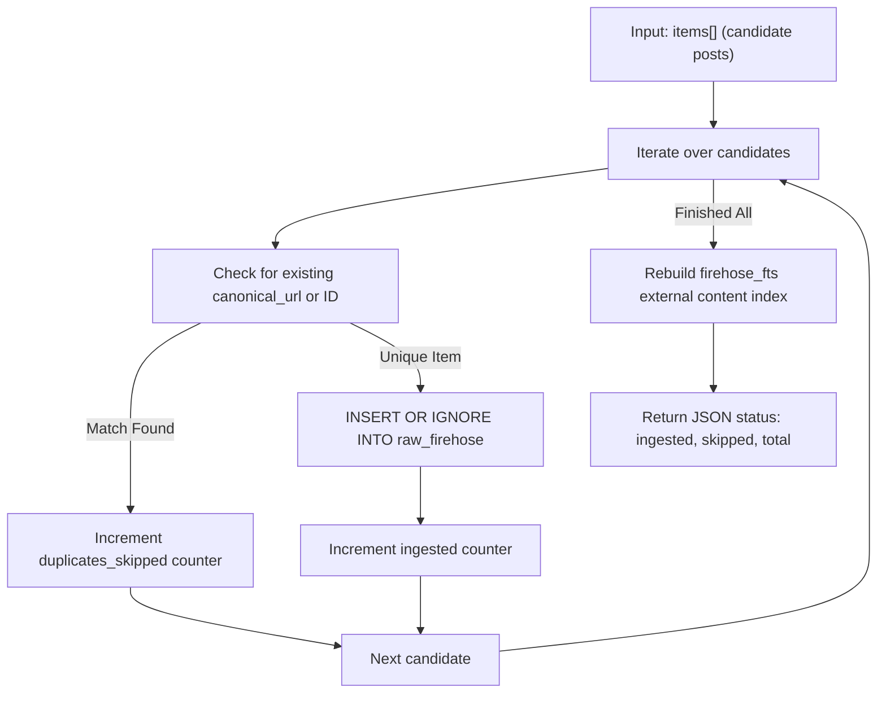

#### Execution Logic
1. Validates that the candidate items array is non-empty.
2. Begins an atomic SQLite transaction (`with conn:`).
3. For each candidate item, extracts `canonical_id` and `canonical_url` (falling back to `id` and `url`).
4. Queries `raw_firehose` for existing duplicates by ID or URL. If a match is found, skips the item.
5. Inserts new items with initial `processed = 0` status and Unix epoch timestamp.
6. Rebuilds the SQLite FTS5 `firehose_fts` virtual table using SQLite's native `rebuild` command.
7. Commits the transaction and returns execution metrics.

#### Database Tables & SQL Queries
* **Primary Table:** `raw_firehose` (Append-only immutable raw storage)
* **Search Index:** `firehose_fts` (SQLite FTS5 virtual table indexing `title` and `content`)
* **SQL Statements:**
  ```sql
  -- Step 1: Duplicate check
  SELECT 1 FROM raw_firehose WHERE id = ? OR canonical_url = ? LIMIT 1;

  -- Step 2: Insert unique post
  INSERT OR IGNORE INTO raw_firehose (id, platform, title, content, canonical_url, processed, created_at)
  VALUES (?, ?, ?, ?, ?, 0, ?);

  -- Step 3: Rebuild FTS5 external content table
  INSERT INTO firehose_fts(firehose_fts) VALUES('rebuild');
  ```

#### Input Parameters
| Parameter | Type | Required? | Default | Description |
| :--- | :--- | :---: | :---: | :--- |
| `items` | array of objects | **Yes** | — | List of post objects to ingest. |

Each object inside the `items` array supports these fields:
- `canonical_url` *(string, required)*: The permanent web link of the post (unique identifier). Alias: `url`.
- `canonical_id` *(string, optional)*: Unique post ID (e.g. tweet ID, Reddit thread ID). Alias: `id`.
- `platform` *(string, optional)*: Source platform (e.g. `"reddit"`, `"twitter"`, `"github"`). Default: `"Unknown"`.
- `title` *(string, optional)*: Title or first line of the post. Default: `"Untitled"`.
- `content` *(string, optional)*: Main text body of the post. Aliases: `text`, `summary`. Default: `""`.

#### Return Structure
```json
{
  "status": "success",
  "ingested": 2,
  "duplicates_skipped": 1,
  "total_processed": 3
}
```

#### Side Effects
- Inserts new rows into the `raw_firehose` SQLite table.
- Rebuilds the `firehose_fts` full-text search index.

#### Example JSON-RPC Request
```json
{
  "jsonrpc": "2.0",
  "id": 101,
  "method": "tools/call",
  "params": {
    "name": "llm_wiki_firehose_ingest",
    "arguments": {
      "items": [
        {
          "canonical_url": "https://github.com/astral-sh/uv/issues/1234",
          "canonical_id": "uv-issue-1234",
          "platform": "github",
          "title": "Resolver lock contention with concurrent builds",
          "content": "When running multi-stage docker builds, the cache lock causes high latency..."
        }
      ]
    }
  }
}
```

---

### 2. `llm_wiki_firehose_query`
*Alias: `firehose_query`*

#### Purpose
Searches through all raw scraped internet posts (Reddit discussions, tweets, GitHub issues) using SQLite FTS5 (Full-Text Search).

#### Architecture & Workflow
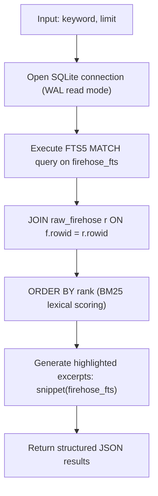

#### Execution Logic
1. Opens a read connection to `raw_firehose.db` (concurrent readers never block writers in WAL mode).
2. Executes an FTS5 `MATCH` query on the virtual table `firehose_fts`.
3. Joins the matching virtual table rows with the primary `raw_firehose` table using SQLite's internal `rowid`.
4. Ranks results using SQLite FTS5's built-in BM25 scoring.
5. Uses SQLite's native `snippet()` function to create highlighted excerpts surrounded by `<b>` tags.
6. Limits the result set and returns metadata (post ID, platform, title, URL, snippet).

#### Database Tables & SQL Queries
* **Tables Read:** `firehose_fts` (FTS5 virtual index), `raw_firehose` (content store)
* **SQL Statement:**
  ```sql
  SELECT r.id, r.platform, r.title, r.canonical_url, snippet(firehose_fts, 1, '<b>', '</b>', '...', 15)
  FROM firehose_fts f
  JOIN raw_firehose r ON f.rowid = r.rowid
  WHERE firehose_fts MATCH ?
  ORDER BY rank
  LIMIT ?;
  ```

#### Input Parameters
| Parameter | Type | Required? | Default | Description |
| :--- | :--- | :---: | :---: | :--- |
| `keyword` | string | **Yes** | — | Search term or phrase to match in post titles and content. |
| `limit` | integer | No | `10` | Maximum number of matching posts to return. |

#### Return Structure
```json
{
  "keyword": "cache lock contention",
  "count": 1,
  "results": [
    {
      "id": "uv-issue-1234",
      "platform": "github",
      "title": "Resolver lock contention with concurrent builds",
      "url": "https://github.com/astral-sh/uv/issues/1234",
      "snippet": "When running multi-stage docker builds, the <b>cache</b> <b>lock</b> causes high latency..."
    }
  ]
}
```

#### Side Effects
- None (read-only search query).

#### Example JSON-RPC Request
```json
{
  "jsonrpc": "2.0",
  "id": 102,
  "method": "tools/call",
  "params": {
    "name": "llm_wiki_firehose_query",
    "arguments": {
      "keyword": "raft consensus latency",
      "limit": 5
    }
  }
}
```

---

### 3. `llm_wiki_search_hybrid`
*Alias: `search_hybrid`*

#### Purpose
Searches existing textbook chapters using a combined **hybrid search engine** fusing SQLite FTS5 BM25 lexical ranking with fastembed vector cosine similarity via Reciprocal Rank Fusion (RRF).

#### Architecture & Workflow
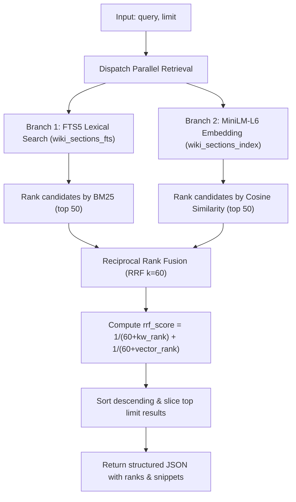

#### Execution Logic
1. Receives natural language query string and limit threshold.
2. **Lexical Pass:** Sanitizes query, strips conversational English stopwords, encases terms in quotes, and queries `wiki_sections_fts`. Gathers up to 50 candidate headings with snippet highlights.
3. **Semantic Pass:** Generates a 384-dimensional dense vector via `all-MiniLM-L6-v2`. Reads all stored section embeddings from `wiki_sections_index`, L2-normalizes vectors, and computes dot-product cosine similarities. Selects top 50 matches.
4. **Reciprocal Rank Fusion (RRF):** Merges candidate lists using $RRF(d) = \sum_{m \in \{kw, vec\}} \frac{1}{60 + r_m(d)}$.
5. Sorts merged candidates by `rrf_score` descending and returns top `limit` results.

#### Database Tables & SQL Queries
* **Full-Text Index:** `wiki_sections_fts` (Virtual FTS5 table)
* **Metadata & Vector Storage:** `wiki_sections_index` (Content, line bounds, and 384-d BLOB embeddings)
* **SQL Statements:**
  ```sql
  -- Branch 1: FTS5 Lexical Search
  SELECT file_path, heading, snippet(wiki_sections_fts, 2, '<b>', '</b>', '...', 12)
  FROM wiki_sections_fts
  WHERE wiki_sections_fts MATCH ?
  LIMIT 50;

  -- Branch 2: Vector Embedding Matrix Load
  SELECT file_path, heading, embedding
  FROM wiki_sections_index
  WHERE embedding IS NOT NULL;
  ```

#### Input Parameters
| Parameter | Type | Required? | Default | Description |
| :--- | :--- | :---: | :---: | :--- |
| `query` | string | **Yes** | — | Natural language search question or topic phrase. |
| `limit` | integer | No | `10` | Maximum number of matching chapter sections to return. |

#### Return Structure
```json
{
  "query": "caching strategies for read-heavy workloads",
  "results": [
    {
      "file": "caching.md",
      "heading": "Read-Through vs Cache-Aside Patterns",
      "rrf_score": 0.0325,
      "kw_rank": 1,
      "vector_rank": 2,
      "vector_similarity": 0.884,
      "snippet": "For read-heavy workloads, <b>Cache-Aside</b> reduces pressure on..."
    }
  ]
}
```

#### Side Effects
- None (read-only search query).

#### Example JSON-RPC Request
```json
{
  "jsonrpc": "2.0",
  "id": 103,
  "method": "tools/call",
  "params": {
    "name": "llm_wiki_search_hybrid",
    "arguments": {
      "query": "distributed consensus leader election",
      "limit": 5
    }
  }
}
```

---

### 4. `llm_wiki_search_keyword`
*Alias: `search_keyword`*

#### Purpose
Performs **pure lexical keyword search** across all textbook chapters using SQLite FTS5 BM25 ranking and stopword filtering.

#### Architecture & Workflow
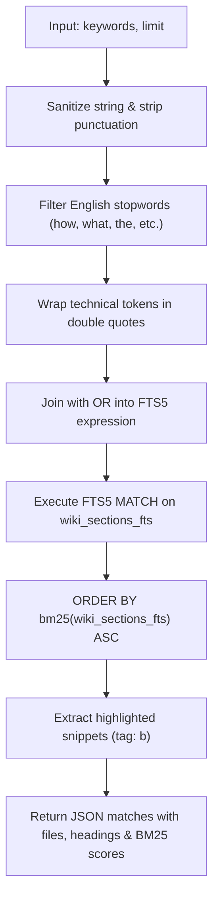

#### Execution Logic
1. Checks that keywords parameter is non-empty.
2. Cleans punctuation characters that could trigger SQLite syntax errors.
3. Filters against an extensive stopword set, retaining substantive technical terms, acronyms, and flags.
4. Encases tokens in double quotes (`"token"`) and joins up to 25 words with `OR`.
5. Queries `wiki_sections_fts`, ordering by native SQLite BM25 ranking (lower score = higher relevance).
6. Uses `snippet()` to return context excerpts with `<b>` highlight tags.

#### Database Tables & SQL Queries
* **Virtual Index:** `wiki_sections_fts` (SQLite FTS5 table indexing `file_path`, `heading`, and `content`)
* **SQL Statement:**
  ```sql
  SELECT file_path, heading, snippet(wiki_sections_fts, 2, '<b>', '</b>', '...', 15), bm25(wiki_sections_fts) as rank
  FROM wiki_sections_fts
  WHERE wiki_sections_fts MATCH ?
  ORDER BY rank
  LIMIT ?;
  ```

#### Input Parameters
| Parameter | Type | Required? | Default | Description |
| :--- | :--- | :---: | :---: | :--- |
| `keywords` | string | **Yes** | — | Keyword phrase or space-separated technical terms. Alias: `query`. |
| `limit` | integer | No | `30` | Maximum matching sections to return. |

#### Return Structure
```json
{
  "keywords": "SQLite WAL locks leader leases",
  "count": 5,
  "results": [
    {
      "file": "consensus.md",
      "heading": "3.1 Leader Leases & SQLite Single-Writer Locks",
      "snippet": "### 3.1 <b>Leader</b> <b>Leases</b> & <b>SQLite</b> Single-Writer <b>Locks</b>...",
      "bm25_rank": -7.9883
    }
  ]
}
```

#### Side Effects
- None (read-only search on SQLite FTS5 table).

#### Example JSON-RPC Request
```json
{
  "jsonrpc": "2.0",
  "id": 103,
  "method": "tools/call",
  "params": {
    "name": "llm_wiki_search_keyword",
    "arguments": {
      "keywords": "BEGIN IMMEDIATE deadlock",
      "limit": 10
    }
  }
}
```

---

### 5. `llm_wiki_search_similarity`
*Alias: `search_similarity`*

#### Purpose
Performs **pure vector semantic similarity search** across all textbook chapters using fastembed sentence embeddings (`all-MiniLM-L6-v2`).

#### Architecture & Workflow
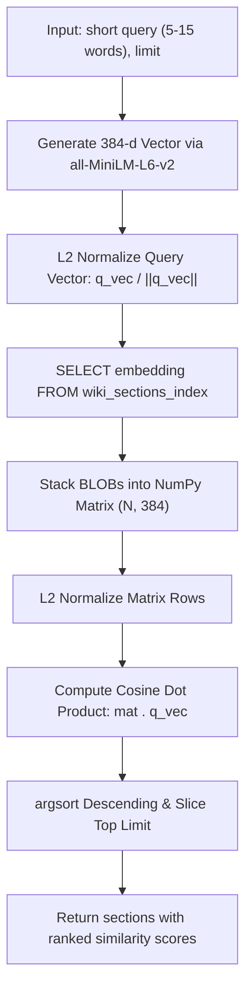

#### Execution Logic
1. Validates that the conceptual prompt is non-empty.
2. Embeds the prompt using fastembed `all-MiniLM-L6-v2` into a 384-dimensional dense float32 array.
3. L2-normalizes the query vector.
4. Queries `wiki_sections_index` for all precomputed binary BLOB embeddings.
5. Stacks raw bytes into a 2D NumPy array and normalizes each row.
6. Computes matrix dot product (`sims = np.dot(mat, q_vec)`).
7. Sorts by cosine similarity descending and returns top `limit` matches.

#### Database Tables & SQL Queries
* **Table Read:** `wiki_sections_index` (Relational table storing chapter headings and binary embeddings)
* **SQL Statement:**
  ```sql
  SELECT file_path, heading, embedding
  FROM wiki_sections_index
  WHERE embedding IS NOT NULL;
  ```

#### Input Parameters
| Parameter | Type | Required? | Default | Description |
| :--- | :--- | :---: | :---: | :--- |
| `query` | string | **Yes** | — | Short, focused conceptual prompt or phrase. |
| `limit` | integer | No | `30` | Maximum matching sections to return. |

#### Return Structure
```json
{
  "query": "preventing database lock escalation deadlocks",
  "count": 5,
  "results": [
    {
      "rank": 1,
      "file": "evaluations.md",
      "heading": "4.1 The Lock Escalation Deadlock Cascade",
      "similarity": 0.6813
    }
  ]
}
```

#### Side Effects
- None (read-only vector dot product query).

#### Example JSON-RPC Request
```json
{
  "jsonrpc": "2.0",
  "id": 104,
  "method": "tools/call",
  "params": {
    "name": "llm_wiki_search_similarity",
    "arguments": {
      "query": "preventing database lock escalation deadlocks",
      "limit": 10
    }
  }
}
```

---

### 6. `llm_wiki_read_section`
*Alias: `read_section`*

#### Purpose
Surgically reads **only the markdown lines under a specific heading** inside a chapter file without reading the whole file into context memory.

#### Architecture & Workflow
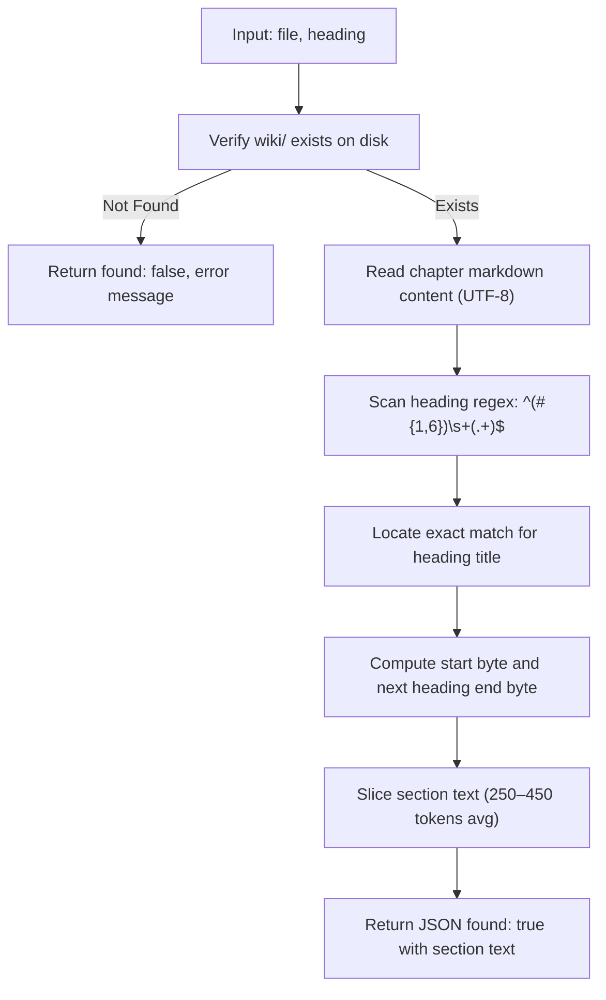

#### Execution Logic
1. Checks if `wiki/<file>` exists on the filesystem.
2. Reads the markdown text using UTF-8 decoding.
3. Parses heading tokens using the `ASTSplicer` heading regular expression.
4. Identifies the line/byte coordinates `[start_pos, end_pos)` for the target heading level.
5. Returns only the sliced section string, leaving all other sections unread.
6. Operates strictly in-process with zero database calls or external daemon dependencies.

#### Database Tables & SQL Queries
* **Database Interactions:** None (direct filesystem CommonMark AST slicing).

#### Input Parameters
| Parameter | Type | Required? | Default | Description |
| :--- | :--- | :---: | :---: | :--- |
| `file` | string | **Yes** | — | Markdown chapter file name inside `wiki/` (e.g. `"caching.md"`). |
| `heading` | string | **Yes** | — | Exact heading title to read (e.g. `"LRU Eviction Policy"`). |

#### Return Structure
```json
{
  "found": true,
  "file": "caching.md",
  "heading": "LRU Eviction Policy",
  "content": "### LRU Eviction Policy\n\nLeast Recently Used (LRU) discards the least recently accessed items first..."
}
```
If the section does not exist:
```json
{
  "found": false,
  "content": "",
  "message": "Heading 'Unknown Heading' not found in caching.md"
}
```

#### Side Effects
- None (read-only file access).

#### Example JSON-RPC Request
```json
{
  "jsonrpc": "2.0",
  "id": 104,
  "method": "tools/call",
  "params": {
    "name": "llm_wiki_read_section",
    "arguments": {
      "file": "consensus.md",
      "heading": "Raft Leader Election"
    }
  }
}
```

---

### 7. `llm_wiki_patch_section`
*Alias: `patch_section`*

#### Purpose
Surgically replaces or appends a specific section inside a chapter file, automatically creates cross-chapter wikilinks, validates syntax, and updates search embeddings.

#### Architecture & Workflow
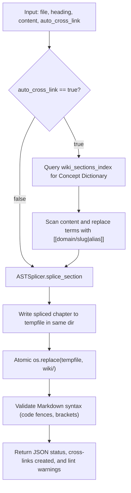

#### Execution Logic
1. **Automatic Cross-Linking:** If `auto_cross_link=True`, loads the sorted concept dictionary from `wiki_sections_index`. Masks code blocks, URLs, and existing brackets, then transforms unlinked terms into `[[domain/slug|alias]]` links.
2. **Surgical AST Splicing:** Finds target heading line coordinates in `wiki/<file>` and swaps the bytes with the updated section (or appends if the heading is new).
3. **Atomic File Write:** Writes content to a temporary file in the same filesystem folder and replaces the original via `os.replace` to prevent partial file writes.
4. **Syntax Linting:** Runs a validation check ensuring that code fences and bracket pairs are balanced.
5. Returns confirmation payload with lists of created cross-links and any syntax warnings.

#### Database Tables & SQL Queries
* **Table Read:** `wiki_sections_index` (for concept dictionary lookup)
* **SQL Statement:**
  ```sql
  SELECT file_path, heading, heading_slug 
  FROM wiki_sections_index 
  WHERE LENGTH(heading) >= ?;
  ```

#### Input Parameters
| Parameter | Type | Required? | Default | Description |
| :--- | :--- | :---: | :---: | :--- |
| `file` | string | **Yes** | — | Markdown chapter file name inside `wiki/` (e.g. `"caching.md"`). |
| `heading` | string | **Yes** | — | Exact heading title to update or append. |
| `content` | string | **Yes** | — | New replacement markdown content for the section. |
| `auto_cross_link` | boolean | No | `true` | If true, automatically scans new content and inserts cross-chapter wikilinks. |

#### Return Structure
```json
{
  "status": "success",
  "file": "storage.md",
  "heading": "Write-Ahead Logging Implementation",
  "cross_links_created": 2,
  "cross_links": [
    {
      "matched_text": "Raft Consensus",
      "target_file": "consensus.md",
      "target_heading": "Raft Consensus",
      "target_link": "[[consensus/raft-consensus|Raft Consensus]]"
    }
  ],
  "lint_warnings": [],
  "message": "Section 'Write-Ahead Logging Implementation' spliced cleanly in storage.md with embeddings and cross-links updated."
}
```

#### Side Effects
- Modifies markdown chapter file on disk (`wiki/<file>`).
- Updates `wiki_sections_index` table (text and vector embedding).
- Rebuilds `wiki_sections_fts` full-text search index.
- Registers newly created wikilinks in `wiki_links`.

#### Example JSON-RPC Request
```json
{
  "jsonrpc": "2.0",
  "id": 105,
  "method": "tools/call",
  "params": {
    "name": "llm_wiki_patch_section",
    "arguments": {
      "file": "storage.md",
      "heading": "Write-Ahead Logging Implementation",
      "content": "### Write-Ahead Logging Implementation\n\nWAL guarantees durability by appending all changes to an append-only log before modifying page tables. This pairs with Raft Consensus for multi-node replication.",
      "auto_cross_link": true
    }
  }
}
```

---

### 8. `llm_wiki_get_graph`
*Alias: `get_graph`*

#### Purpose
Inspects the textbook knowledge graph to understand how topics connect across chapters.

#### Supported Actions
1. **`backlinks` (Who cites this topic?):**
   Returns all chapters and headings that link to the requested concept.
2. **`related` (What topics are cited together?):**
   Returns co-cited concepts (topics that frequently appear in the same sections as this concept).
3. **`dangling` (What topics are missing?):**
   Finds concepts that are cited in wikilinks throughout the textbook but do not yet have a written section in any chapter. These represent textbook "knowledge voids" that need to be researched and authored.

#### Architecture & Workflow
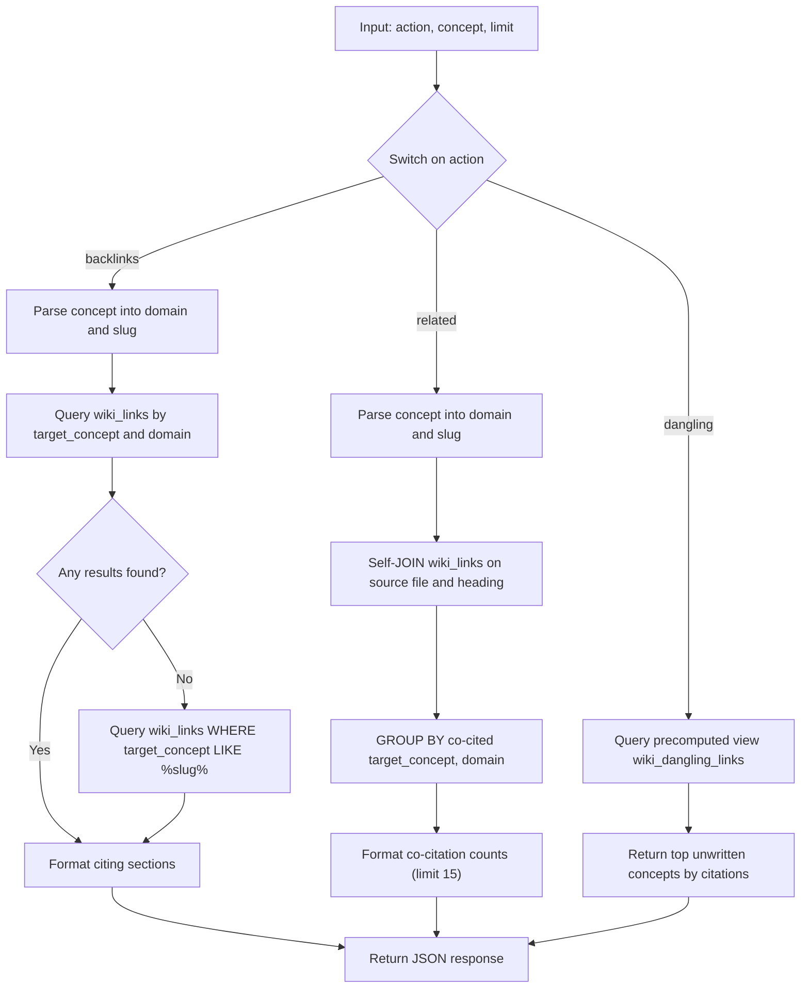

#### Execution Logic
1. **Action Routing:** Inspects the `action` parameter (`backlinks`, `related`, or `dangling`).
2. **Backlinks Mode (`action="backlinks"`):**
   - Normalizes concept into `domain` and `slug` using `parse_wikilink`.
   - Executes an exact lookup on the `wiki_links` table (`target_concept = ? AND domain_scope = ?` if a domain is specified, or `target_concept = ?`).
   - If zero exact matches exist, runs a fallback substring wildcard search (`target_concept LIKE ?` with limit 25).
   - Formats and returns all citing source chapters, source headings, target anchors, and aliases.
3. **Related Concepts Mode (`action="related"`):**
   - Normalizes concept into `domain` and `slug`.
   - Executes a self-join on `wiki_links` (`l1` and `l2`) matching records with the same `source_file` and `source_heading`.
   - Groups by `target_concept` and `domain_scope`, counting shared citations, and returns the top 15 co-cited topics.
4. **Dangling Links Mode (`action="dangling"`):**
   - Queries the SQL VIEW `wiki_dangling_links` which aggregates all target concepts cited in wikilinks that do not match any existing section slug or chapter file in `wiki_sections_index`.
   - Sorts missing topics by incoming citation count in descending order up to `limit`.
5. **Zero Mutation Invariant:** Executes read-only queries with zero side effects on disk files or database tables.

#### Database Tables & SQL Queries
* **Tables & Views Read:** `wiki_links`, `wiki_dangling_links` (view)
* **SQL Statements:**
  - Backlinks Query:
    ```sql
    SELECT source_file, source_heading, target_concept, target_anchor, link_alias, domain_scope
    FROM wiki_links
    WHERE target_concept = ? AND domain_scope = ?
    ORDER BY source_file, source_heading;
    ```
  - Backlinks Substring Fallback:
    ```sql
    SELECT source_file, source_heading, target_concept, target_anchor, link_alias, domain_scope
    FROM wiki_links
    WHERE target_concept LIKE ?
    ORDER BY source_file, source_heading
    LIMIT 25;
    ```
  - Related Concepts Query:
    ```sql
    SELECT l2.target_concept, l2.domain_scope, COUNT(*) as co_citation_count
    FROM wiki_links l1
    JOIN wiki_links l2 
      ON l1.source_file = l2.source_file 
     AND l1.source_heading = l2.source_heading
    WHERE (l1.target_concept = ? OR (l1.target_concept = ? AND l1.domain_scope = ?))
      AND l2.target_concept != ?
    GROUP BY l2.target_concept, l2.domain_scope
    ORDER BY co_citation_count DESC
    LIMIT 15;
    ```
  - Dangling Links Query:
    ```sql
    SELECT target_concept, domain_scope, incoming_citations, citing_files
    FROM wiki_dangling_links
    LIMIT ?;
    ```

#### Input Parameters
| Parameter | Type | Required? | Default | Description |
| :--- | :--- | :---: | :---: | :--- |
| `action` | string | **Yes** | `"backlinks"` | One of: `"backlinks"`, `"related"`, or `"dangling"`. |
| `concept` | string | Required for backlinks/related | `""` | Concept slug or topic title (e.g. `"raft"` or `"consensus/raft"`). |
| `limit` | integer | No | `20` | Maximum number of graph items to return. |

#### Return Structure

##### When `action="backlinks"`:
```json
{
  "action": "backlinks",
  "concept": "raft",
  "results": [
    {
      "source_file": "storage.md",
      "source_heading": "Write-Ahead Logging Implementation",
      "target_concept": "raft",
      "target_anchor": "",
      "link_alias": "Raft Consensus",
      "domain_scope": "consensus"
    }
  ]
}
```

##### When `action="dangling"`:
```json
{
  "action": "dangling",
  "results": [
    {
      "target_concept": "zero-copy-serialization",
      "domain_scope": "networking",
      "incoming_citations": 8,
      "citing_files": "storage.md, consensus.md"
    }
  ]
}
```

#### Side Effects
- None (read-only graph inspection).

#### Example JSON-RPC Request
```json
{
  "jsonrpc": "2.0",
  "id": 106,
  "method": "tools/call",
  "params": {
    "name": "llm_wiki_get_graph",
    "arguments": {
      "action": "dangling",
      "limit": 10
    }
  }
}
```

---

### 9. `llm_wiki_suggest_links`
*Alias: `suggest_links`*

#### Purpose
Analyzes vector embeddings across all chapter sections to find pairs of sections in different chapters that discuss related topics but are not yet linked.

#### How It Works
It calculates the cosine similarity (a measure of how close two text meanings are) across all section embeddings. If two sections in different chapters exceed the threshold (default: 0.82) and do not already link to each other, they are suggested as candidates for cross-linking.

> [!WARNING]
> **Similarity Scores Are Unverified Heuristics, Not Ground Truth:**
> High vector cosine similarity (> 0.82) often occurs between unrelated sections due to shared technical vocabulary (e.g. "memory", "benchmarks", "latency"), boilerplate phrasing, or news announcements. Agents must **NEVER** automatically create links based on similarity scores alone. Always run the **4-Point Epistemic Link Audit**:
> 1. **Causal/Architectural Dependency:** Verify that Section A directly relies on, implements, or configures the mechanism in Section B.
> 2. **Substantive Concepts Only:** Ensure both targets are permanent technical concepts, never raw scraped forum posts, model cards, or news digests.
> 3. **No Conversational Filler:** Reject links to generic headings like "the context" or "the use case".
> 4. **1-Sentence Justification:** State the explicit architectural reason connecting the two mechanisms before adding the link.

#### Architecture & Workflow
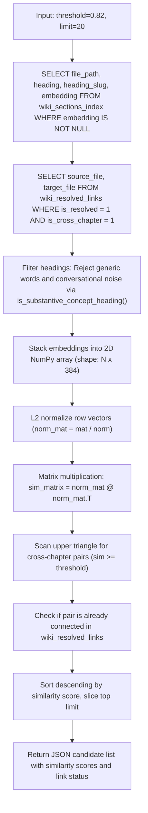

#### Execution Logic
1. **Embedding Matrix Loading:** Retrieves all section records from `wiki_sections_index` where precomputed dense vector embeddings are present.
2. **Existing Link Edge Loading:** Reads all established cross-chapter links from the `wiki_resolved_links` SQL view to identify existing connections.
3. **Substantive Concept Filtering:** Passes each heading through `is_substantive_concept_heading()`, discarding generic section names (such as `"Overview"`, `"Summary"`, `"Architecture"`, `"Benchmarks"`) and conversational noise.
4. **Vector Normalization & Matrix Dot Product:** Deserializes raw binary vector blobs into 384-dimensional float32 vectors and stacks them into an `(N, 384)` NumPy matrix. Normalizes rows by their Euclidean L2 norm and computes the complete pairwise cosine similarity matrix with a single dot product (`norm_mat @ norm_mat.T`).
5. **Cross-Chapter Pair Extraction:** Evaluates upper-triangular matrix indices where `source_file != target_file` and similarity meets or exceeds `threshold`.
6. **Edge Presence Flagging:** Checks whether an active link already exists between the two files in `existing_edges`, setting `is_already_linked`.
7. **Sorting & Limiting:** Sorts candidate pairs in descending order of similarity score and returns the top `limit` candidate pairs.
8. **Pure Read-Only Safety:** Performs all vector calculations in memory without altering database tables or markdown chapters.

#### Database Tables & SQL Queries
* **Tables & Views Read:** `wiki_sections_index`, `wiki_resolved_links` (view)
* **SQL Statements:**
  - Retrieve Indexed Section Vectors:
    ```sql
    SELECT file_path, heading, heading_slug, embedding 
    FROM wiki_sections_index 
    WHERE embedding IS NOT NULL;
    ```
  - Retrieve Existing Cross-Chapter Graph Edges:
    ```sql
    SELECT source_file, target_file 
    FROM wiki_resolved_links 
    WHERE is_resolved = 1 AND is_cross_chapter = 1;
    ```

#### Input Parameters
| Parameter | Type | Required? | Default | Description |
| :--- | :--- | :---: | :---: | :--- |
| `threshold` | number | No | `0.82` | Minimum cosine similarity score (between 0.0 and 1.0). |
| `limit` | integer | No | `20` | Maximum candidate pairs to return. |

#### Return Structure
```json
{
  "status": "success",
  "threshold": 0.82,
  "count": 1,
  "suggestions": [
    {
      "source_file": "agent_architectures.md",
      "source_heading": "Hierarchical Planner Patterns",
      "source_slug": "hierarchical-planner-patterns",
      "target_file": "orchestration.md",
      "target_heading": "Multi-Agent Task Decomposition",
      "target_slug": "multi-agent-task-decomposition",
      "similarity": 0.865,
      "is_already_linked": false
    }
  ]
}
```

#### Side Effects
- None (read-only calculation across existing database vector embeddings).

#### Example JSON-RPC Request
```json
{
  "jsonrpc": "2.0",
  "id": 107,
  "method": "tools/call",
  "params": {
    "name": "llm_wiki_suggest_links",
    "arguments": {
      "threshold": 0.85,
      "limit": 10
    }
  }
}
```

---

### 10. `llm_wiki_scan_links`
*Alias: `scan_links`*

#### Purpose
Scans an entire markdown chapter against all 5,360+ known textbook concepts to discover or apply cross-chapter wikilinks.

#### Dry-Run Mode vs Apply Mode
- **Dry-run (`apply: false`, default):** Scans the file and returns a list of all potential cross-chapter links discovered without changing the file on disk.
- **Apply (`apply: true`):** Writes the modified text to disk with `[[chapter/slug|alias]]` links inserted, and refreshes the database link index.

#### Architecture & Workflow
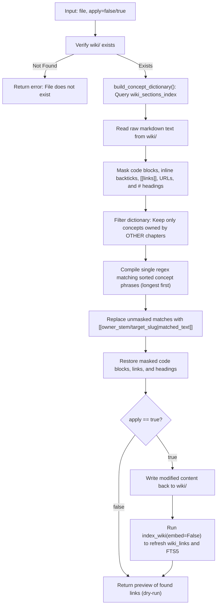

#### Execution Logic
1. **Target Existence Check:** Verifies that `wiki/<file>` exists on the local disk.
2. **Concept Dictionary Assembly:** Queries all section headings from `wiki_sections_index`, filters out generic and conversational phrases using `is_substantive_concept_heading()`, and constructs a dictionary mapping lowercase concept phrases to `(owner_file, target_slug, original_heading)`. Sorts phrases by length descending to prevent sub-string collision.
3. **Syntax Shielding & Token Masking:** Masks fenced code blocks (```` ``` ````), inline code spans (`` `...` ``), existing wikilinks (`[[...]]`), URLs (`http://`, `https://`), and Markdown heading lines (`# ...`) with placeholder tokens (`\x1fMASK_N\x1f`).
4. **Cross-Chapter Boundary Enforcement:** Filters out concepts that belong to the current file so that sections are never linked within their own chapter.
5. **Regex Search & Link Insertion:** Compiles a regex containing all target phrases sorted longest-first to prevent sub-phrase truncation. Replaces matching phrases with standard wikilinks: `[[owner_stem/target_slug|Matched Text]]`.
6. **Mask Unwrapping:** Restores all protected code blocks, URLs, and existing links in reverse index order.
7. **Branching on Apply Flag:**
   - If `apply=False` (default dry-run): Returns a preview list of all detected cross-chapter links without modifying the chapter file or database.
   - If `apply=True`: Overwrites `wiki/<file>` on disk with the linked markdown and executes `index_wiki(embed=False)` to rebuild `wiki_links` and `wiki_sections_fts`.

#### Database Tables & SQL Queries
* **Tables Read:** `wiki_sections_index` (for concept dictionary lookup)
* **Tables Modified (when `apply=true`):** `wiki_links`, `wiki_sections_fts`
* **SQL Statements:**
  - Concept Dictionary Lookup:
    ```sql
    SELECT file_path, heading, heading_slug 
    FROM wiki_sections_index 
    WHERE LENGTH(heading) >= ?;
    ```
  - Re-indexing Graph and FTS5 (executed when `apply=true` via `index_wiki`):
    ```sql
    DELETE FROM wiki_links;
    INSERT OR IGNORE INTO wiki_links (source_file, source_heading, target_concept, target_anchor, link_alias, domain_scope)
    VALUES (?, ?, ?, ?, ?, ?);
    INSERT INTO wiki_sections_fts(wiki_sections_fts) VALUES('rebuild');
    ```

#### Input Parameters
| Parameter | Type | Required? | Default | Description |
| :--- | :--- | :---: | :---: | :--- |
| `file` | string | **Yes** | — | Markdown chapter file name inside `wiki/` (e.g. `"caching.md"`). |
| `apply` | boolean | No | `false` | If true, writes the generated cross-links to disk and updates the index. |

#### Return Structure
```json
{
  "status": "success",
  "file": "caching.md",
  "applied_count": 14,
  "applied_changes": true,
  "links_found": [
    {
      "matched_text": "Consistent Hashing",
      "target_file": "networking.md",
      "target_heading": "Consistent Hashing Ring",
      "target_link": "[[networking/consistent-hashing-ring|Consistent Hashing]]"
    }
  ]
}
```

#### Side Effects
- If `apply=true`: Modifies `wiki/<file>` on disk and refreshes the `wiki_links` table in SQLite.
- If `apply=false`: None (read-only preview).

#### Example JSON-RPC Request
```json
{
  "jsonrpc": "2.0",
  "id": 108,
  "method": "tools/call",
  "params": {
    "name": "llm_wiki_scan_links",
    "arguments": {
      "file": "agent_architectures.md",
      "apply": false
    }
  }
}
```

---

### 11. `llm_wiki_git_commit_and_push`
*Alias: `git_commit_and_push`*

#### Purpose
Atomically stages modified chapter files, creates a Git commit, and pushes changes to the remote GitHub repository.

#### When to Use
Use this tool immediately after completing a batch of section updates to ensure changes are safely version-controlled and synchronized with the remote repository.

#### Architecture & Workflow
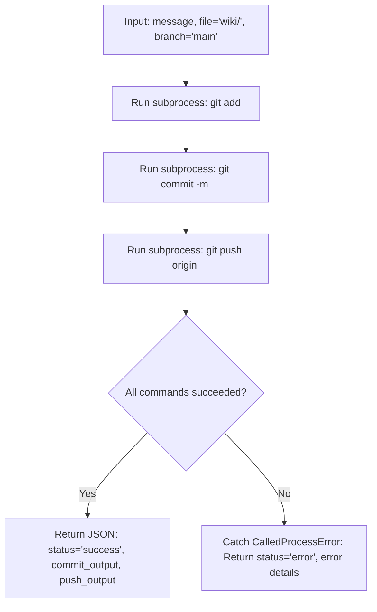

#### Execution Logic
1. **Workspace Boundary:** Executes all Git commands with current working directory locked to `WORKSPACE_ROOT`.
2. **Atomic Staging (`git add`):** Runs `git add <file>` (defaulting to the entire `wiki/` directory) to stage all modified markdown chapters into the Git index.
3. **Commit Creation (`git commit`):** Executes `git commit -m <message>`, capturing commit hash and diff summary output.
4. **Remote Synchronization (`git push`):** Pushes commits to the upstream GitHub tracking branch (`git push origin <branch>`).
5. **Subprocess Failure Handling:** Traps any `CalledProcessError` (e.g., merge conflicts, authentication rejection, or invalid paths), preventing server process crashes and returning actionable error messages.

#### Database Tables & SQL Queries
* **Database Interactions:** None (direct operating system process execution via Python `subprocess.run` targeting the local Git repository).

#### Input Parameters
| Parameter | Type | Required? | Default | Description |
| :--- | :--- | :---: | :---: | :--- |
| `message` | string | **Yes** | — | Descriptive Git commit message explaining what was updated. |
| `file` | string | No | `"wiki/"` | Relative path of the file or directory to stage with `git add`. |
| `branch` | string | No | `"main"` | Remote Git branch to push to. |

#### Return Structure
```json
{
  "status": "success",
  "branch": "main",
  "commit_output": "[main abc1234] feat(storage): add Write-Ahead Logging deep dive\n 1 file changed, 45 insertions(+)",
  "push_output": "To https://github.com/user/llm-wiki.git\n   def5678..abc1234  main -> main"
}
```

#### Side Effects
- Stages files in local Git index (`git add <file>`).
- Creates a commit in local Git history (`git commit -m <message>`).
- Pushes commits to the remote GitHub tracking branch (`git push origin <branch>`).

#### Example JSON-RPC Request
```json
{
  "jsonrpc": "2.0",
  "id": 109,
  "method": "tools/call",
  "params": {
    "name": "llm_wiki_git_commit_and_push",
    "arguments": {
      "message": "feat(caching): add redis cluster failover nuances",
      "file": "wiki/caching.md",
      "branch": "main"
    }
  }
}
```

---

### 12. `llm_wiki_reindex`
*Alias: `reindex`*

#### Purpose
Rebuilds the relational shadow tables (`wiki_sections_index`, `wiki_links`), FTS5 lexical index, and optionally vector embeddings from all markdown chapters in `wiki/`.

#### Workflow & Guarantees
1. Scans every `.md` file inside `wiki/`.
2. Parses section headers, calculates precise line boundaries, and updates `wiki_sections_index`.
3. Extracts all `[[target/concept|alias]]` cross-references and updates `wiki_links` graph edges.
4. Rebuilds `wiki_sections_fts` for instant sub-15ms BM25 text searching.
5. If `embed=true`, computes fastembed 384-dimensional vector embeddings for new or updated sections.

#### Architecture & Workflow
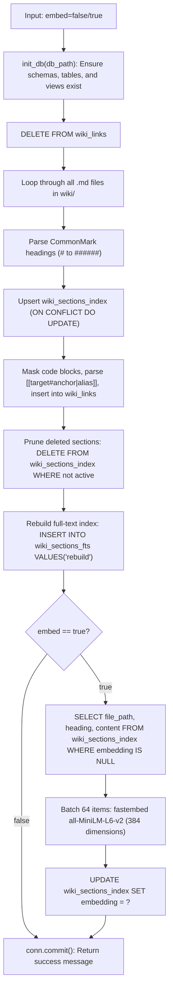

#### Execution Logic
1. **Schema Initialization:** Executes `init_db(db_path)` to ensure WAL mode, pragmas, relational tables (`wiki_sections_index`, `wiki_links`, `raw_firehose`, `active_leases`), FTS5 virtual tables, and analytical views exist.
2. **Topological Graph Reset:** Clears `wiki_links` (`DELETE FROM wiki_links;`) to allow edge recalculation without stale references.
3. **AST Heading Extraction:** Iterates through every markdown chapter file in `wiki/`. Identifies CommonMark heading markers (`#` through `######`) and calculates exact section boundaries `[start_pos, end_pos)`.
4. **Relational Upsert with Embedding Invalidation:** Inserts or updates sections into `wiki_sections_index`. If content has changed, sets `embedding = NULL` so modified sections get freshly embedded.
5. **Wikilink & Edge Extraction:** Strips fenced code blocks and inline code backticks, parses `[[target#anchor|alias]]` structures, resolves domain scopes, and inserts edges into `wiki_links`.
6. **Orphan Section Pruning:** Compares database rows against sections found on disk and deletes removed entries from `wiki_sections_index`.
7. **FTS5 Index Synchronization:** Executes `INSERT INTO wiki_sections_fts(wiki_sections_fts) VALUES('rebuild');` to synchronize the full-text search index.
8. **Optional Vector Embedding Pass:** If `embed=True`, queries all sections where `embedding IS NULL`, generates 384-dimensional dense vectors in batches of 64 using `all-MiniLM-L6-v2`, and writes binary vector blobs to `wiki_sections_index`.

#### Database Tables & SQL Queries
* **Tables & Views Modified:** `wiki_links`, `wiki_sections_index`, `wiki_sections_fts`
* **SQL Statements:**
  - Clear Existing Graph Edges:
    ```sql
    DELETE FROM wiki_links;
    ```
  - Upsert Section Record:
    ```sql
    INSERT INTO wiki_sections_index (file_path, heading, heading_slug, level, content)
    VALUES (?, ?, ?, ?, ?)
    ON CONFLICT(file_path, heading) DO UPDATE SET
        heading_slug = excluded.heading_slug,
        level = excluded.level,
        embedding = CASE WHEN wiki_sections_index.content = excluded.content THEN wiki_sections_index.embedding ELSE NULL END,
        content = excluded.content;
    ```
  - Register Graph Edge:
    ```sql
    INSERT OR IGNORE INTO wiki_links 
    (source_file, source_heading, target_concept, target_anchor, link_alias, domain_scope) 
    VALUES (?, ?, ?, ?, ?, ?);
    ```
  - Prune Orphaned Sections:
    ```sql
    DELETE FROM wiki_sections_index WHERE file_path = ? AND heading = ?;
    ```
  - Rebuild FTS5 Index:
    ```sql
    INSERT INTO wiki_sections_fts(wiki_sections_fts) VALUES('rebuild');
    ```
  - Query Unembedded Sections (when `embed=true`):
    ```sql
    SELECT file_path, heading, content 
    FROM wiki_sections_index 
    WHERE embedding IS NULL;
    ```
  - Update Vector Embedding BLOB (when `embed=true`):
    ```sql
    UPDATE wiki_sections_index 
    SET embedding = ? 
    WHERE file_path = ? AND heading = ?;
    ```

#### Input Parameters
| Parameter | Type | Required? | Default | Description |
| :--- | :--- | :---: | :---: | :--- |
| `embed` | boolean | No | `false` | If true, computes vector embeddings for all updated sections. |

#### Return Structure
```json
{
  "status": "success",
  "embed": false,
  "message": "Wiki successfully re-indexed into shadow tables, FTS5, and link graph."
}
```

#### Side Effects
- Modifies SQLite database tables (`wiki_sections_index`, `wiki_links`, `wiki_sections_fts`).
- Does not modify markdown files on disk.

#### Example JSON-RPC Request
```json
{
  "jsonrpc": "2.0",
  "id": 110,
  "method": "tools/call",
  "params": {
    "name": "llm_wiki_reindex",
    "arguments": {
      "embed": false
    }
  }
}
```

---

## 5. Recommended Agent Workflows

### Workflow A: The Continuous Research & Synthesis Loop
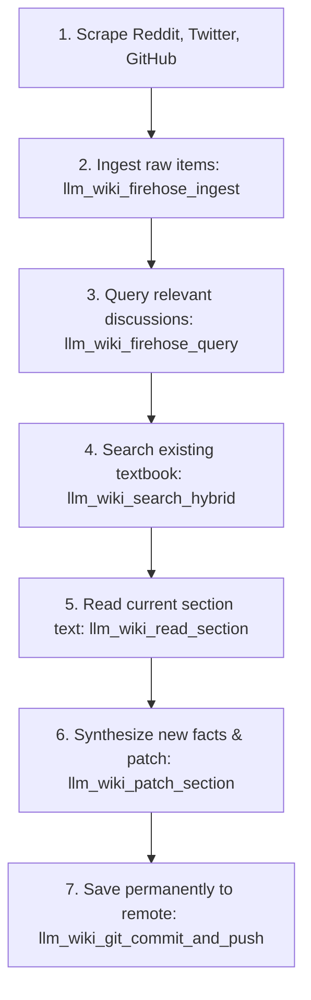

1. **Ingest Fresh Findings:** Scraped items are pushed via [`llm_wiki_firehose_ingest`](#1-llm_wiki_firehose_ingest). Duplicates are filtered out automatically.
2. **Retrieve Real-World Evidence:** Query the raw discussions via [`llm_wiki_firehose_query`](#2-llm_wiki_firehose_query) to collect real-world benchmarks, war stories, and edge cases.
3. **Inspect the Chapter:** Find where this knowledge belongs using [`llm_wiki_search_hybrid`](#3-llm_wiki_search_hybrid) (or pure [`llm_wiki_search_keyword`](#4-llm_wiki_search_keyword) / [`llm_wiki_search_similarity`](#5-llm_wiki_search_similarity)) and read the existing section text with [`llm_wiki_read_section`](#6-llm_wiki_read_section).
4. **Surgically Update:** Call [`llm_wiki_patch_section`](#7-llm_wiki_patch_section). The server automatically creates cross-chapter wikilinks and recalculates search vector embeddings.
5. **Commit and Push:** Commit and push the updated chapter via [`llm_wiki_git_commit_and_push`](#11-llm_wiki_git_commit_and_push).

---

### Workflow B: The Knowledge Graph & Cross-Linking Loop
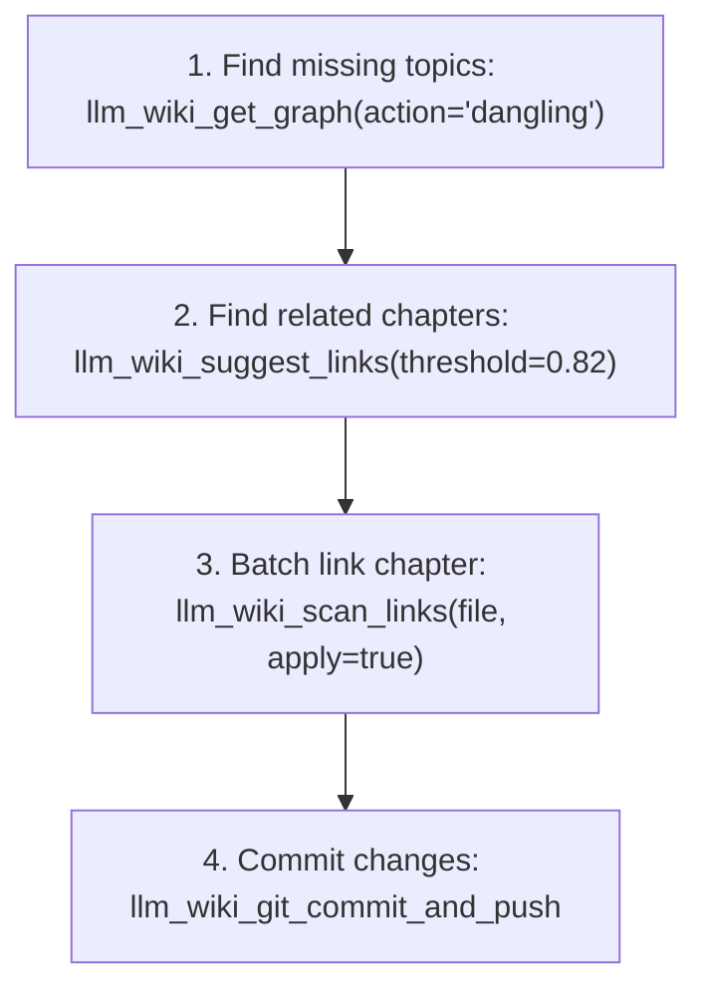

1. **Discover Knowledge Voids:** Call [`llm_wiki_get_graph(action='dangling')`](#8-llm_wiki_get_graph) to see which concepts are cited the most across chapters but haven't been written yet.
2. **Surface Unlinked Relations:** Call [`llm_wiki_suggest_links`](#9-llm_wiki_suggest_links) to see high-similarity section pairs that should connect.
3. **Weave the Graph:** Call [`llm_wiki_scan_links(apply=true)`](#10-llm_wiki_scan_links) to convert unlinked topic names into proper cross-chapter links.
4. **Save:** Push the newly connected graph to GitHub via [`llm_wiki_git_commit_and_push`](#11-llm_wiki_git_commit_and_push).

---

## 6. Error Handling & Edge Cases

| Error Code / Message | Cause | Resolution |
| :--- | :--- | :--- |
| `Tool '<name>' not found` (`-32601`) | Tool name was misspelled or unregistered. | Use canonical names (e.g. `llm_wiki_search_hybrid`) or supported short aliases (e.g. `search_hybrid`). |
| `File '<file>' does not exist in wiki/` | The specified chapter file is not in `wiki/`. | Verify file name exists in `wiki/` (e.g. `caching.md`, not `docs/caching.md`). |
| `Heading '<heading>' not found` | The requested heading does not match any markdown header in the file. | Run `llm_wiki_search_hybrid` first to see the exact heading text. |
| `Unknown graph action '<action>'` | Action was not one of `backlinks`, `related`, or `dangling`. | Specify a valid action string. |
| `Git error: fatal: pathspec did not match` | File path given to git staging does not exist. | Pass a valid relative path (e.g. `wiki/` or `wiki/storage.md`). |
