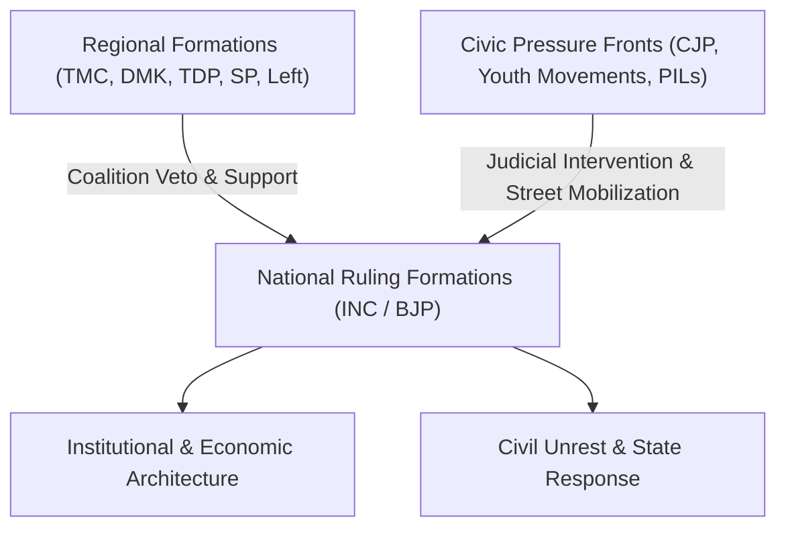

# 9. Indian Political Governance, Coalition Dynamics & Civic Movements

*Deterministic comparative analysis of the historical records of the Indian National Congress (INC) and Bharatiya Janata Party (BJP), coalition mechanisms, and civic pressure formations.*

---

## 1. Conceptual Foundation & Governance Architecture

Post-colonial Indian political governance operates within an asymmetric federal parliamentary constitutional republic. Two dominant national formations—the Indian National Congress (INC, governing for ~54 years) and the Bharatiya Janata Party (BJP, governing for ~16 years across NDA-I, II, and III)—have alternated between single-party hegemony and multi-party coalition dependencies. 

Under the Karpathy three-layer wiki taxonomy, this chapter formalizes the operational mechanisms of Indian governance: macroeconomic transition paths, constitutional crisis management, coalition veto leverage, and extra-parliamentary pressure exerted by civil society litigators and youth movements.

---

### 2.1 Indian National Congress (INC) Milestones
* **Institutional Foundation & Scientific Infrastructure (1947–1964)**:
  * Established premier scientific, educational, and technical institutions: Indian Institutes of Technology (IIT Kharagpur 1951 through Delhi 1961), IIMs, and AIIMS (1956).
  * Institutionalized atomic energy (Atomic Energy Commission 1948 under Homi Bhabha) and space research (INCOSPAR 1962 / ISRO 1969 under Vikram Sarabhai).
  * Built public-sector river valley infrastructure: Bhakra Nangal, Hirakud, and DVC dams.
* **Agricultural Self-Sufficiency (1960s–1970s)**:
  * **Green Revolution**: Introduction of High-Yielding Variety (HYV) seeds, subsidized inputs, minimum support prices (MSP), and Food Corporation of India (FCI, 1965), transitioning India from PL-480 food-aid dependency to grain self-sufficiency.
  * **White Revolution (Operation Flood, 1970)**: Setup of NDDB under Verghese Kurien, establishing smallholder cooperative networks that made India the world's leading dairy producer.
* **Geopolitical & Strategic Milestones**:
  * **Non-Aligned Movement (NAM) & Cold War Balancing**: Spearheaded NAM following the 1955 Bandung Conference alongside Yugoslavia and Egypt; navigated Cold War bipolarity via the 1971 Indo-Soviet Treaty of Friendship and Peace while avoiding formal treaty alliances; initiated the Look East policy in 1991.
  * **1971 Bangladesh Liberation War**: Decisive military victory over Pakistan leading to the surrender of 93,000 Pakistani personnel in Dhaka and the creation of Bangladesh.
  * **Pokhran-I (1974)**: Inaugurated indigenous nuclear testing (*Smiling Buddha*).
  * **Indo-US Civil Nuclear Agreement (2008)**: Prime Minister Dr. Manmohan Singh negotiated the 123 Agreement and secured an unconditional NSG waiver, ending 34 years of global nuclear isolation.
* **1991 Economic Liberalization & Rights-Based Welfare (2004–2014)**:
  * **Structural Reforms (1991)**: Prime Minister P.V. Narasimha Rao and Finance Minister Dr. Manmohan Singh dismantled the industrial licensing "License Raj", reduced peak tariffs from >300% to 50%, devalued the rupee, and initiated current account convertibility.
  * **Rights-Based Entitlements**: Enacted the Right to Information Act (RTI 2005), MGNREGA (2005) guaranteeing 100 days of rural wage labor, RTE (2009), NFSA (2013), and initiated the biometric [[aadhaar_identity_stack|Aadhaar identity architecture]] in 2009.

### 2.2 Bharatiya Janata Party (BJP) Milestones
* **Physical Infrastructure Velocity & Modernization**:
  * **Highways & Connectivity**: Launched the National Highways Development Project (Golden Quadrilateral) under Atal Bihari Vajpayee. Under Narendra Modi, national highway network expanded from 91,287 km (2014) to >146,000 km (2024) under Bharatmala Pariyojana, raising construction pacing from ~12 km/day to ~28–34 km/day.
  * **Railways & Rural Roads**: Achieved >95% broad-gauge rail electrification, operationalized Western and Eastern Dedicated Freight Corridors (DFCs), and deployed indigenous Vande Bharat semi-high-speed trainsets.
* **Digital Public Infrastructure (India Stack) & Saturation Transfers**:
  * **Financial Inclusion (PMJDY)**: Opened >510 million no-frills Jan Dhan bank accounts (>55% women-owned).
  * **JAM Trinity & Direct Benefit Transfer (DBT)**: Scaled direct subsidy transfers exceeding Rs 34 lakh crore ($410B), eliminating an estimated Rs 2.7 lakh crore in intermediary leakage.
  * **Unified Payments Interface (UPI)**: Scaled NPCI payment rails to process >13 billion monthly transactions (accounting for nearly half of global real-time digital payments).
* **Strategic Deterrence & Defense Indigenization**:
  * **Pokhran-II (May 1998)**: Conducted five underground nuclear tests (*Operation Shakti*), formally declaring India an operational nuclear-weapon state under a doctrine of "Credible Minimum Deterrence" and "No First Use".
  * **Kargil War (1999)**: Recaptured mountain posts during *Operation Vijay* with diplomatic isolation of the adversary.
  * **Active Deterrence & Indigenization**: Cross-LoC surgical strikes (2016) and Balakot airstrikes (2019); commissioned first indigenous aircraft carrier INS Vikrant (2022); raised defense exports past Rs 21,000 crore ($2.5B) in FY24.
* **Strategic Multi-Alignment & Geopolitical Expansion**:
  * Transitioned strategic doctrine from non-alignment to active multi-alignment; elevated the Quadrilateral Security Dialogue (Quad) with the United States, Japan, and Australia; institutionalized the I2U2 grouping and India-Middle East-Europe Economic Corridor (IMEC).
  * Maintained strategic autonomy by procuring discounted energy from Russia amid Western sanctions while simultaneously deepening US defense and technology transfers (iCET).
* **Structural Fiscal & Tax Modernization**:
  * Enacted the Goods and Services Tax (GST, 2017) unifying 17 central and state taxes into a common market.
  * Enacted the Insolvency and Bankruptcy Code (IBC, 2016), recovering >Rs 3 lakh crore and bringing banking gross NPAs from >11% to ~2.8% by 2024.
  * Saturation amenities: Constructed >110M household latrines (Swachh Bharat), provided piped water to >150M rural households (Jal Jeevan Mission), and granted Rs 5 lakh health coverage to 550M citizens (Ayushman Bharat).

### 3.1 Indian National Congress (INC)
* **Internal Emergency (1975–1977)**: Invoked Article 352, suspended fundamental rights (Articles 14, 19, 21), detained >110,000 opposition leaders and activists under MISA, imposed press pre-censorship, enacted the 42nd Amendment curtailing judicial review, and executed forced sterilization drives (documented by the Shah Commission).
* **Judicial Supersession & Institutional Overreach**: Systemic executive conflict with judicial independence under Indira Gandhi, highlighted by the 1973 supersession of three senior Supreme Court justices (J.M. Shelat, K.S. Hegde, and A.N. Grover) to appoint A.N. Ray as Chief Justice following the *Kesavananda Bharati* basic structure ruling, and the 1977 supersession of Justice H.R. Khanna following his lone dissent in *ADM Jabalpur v. Shivkant Shukla*.
* **Operation Blue Star & 1984 Anti-Sikh Violence**: Military assault on the Golden Temple in June 1984 followed by the October 1984 anti-Sikh pogrom (~3,000 killed in Delhi); Justice Nanavati Commission (2005) confirmed systemic police inaction and complicity of local Congress leaders.
* **Shah Bano Reversal & Communal Concessions (1985–1986)**: Legislative overturning of the Supreme Court alimony verdict in *Mohd. Ahmed Khan v. Shah Bano Begum* via the Muslim Women Act 1986, accompanied by the reopening of the Babri Masjid locks in Ayodhya in 1986.
* **License-Permit Raj Stagnation & 1991 Crisis**: State monopolization, nationalization of banks (1969/1980), and MRTP Act suppressed private growth, culminating in the 1991 balance-of-payments crisis where forex reserves dropped to $1.2B, requiring pledging 67 tonnes of gold.
* **Corruption Allegations & UPA-II Policy Paralysis**: Bofors kickback allegations (1987); CAG audit findings of presumptive losses in 2G Spectrum (Rs 1.76 lakh crore) and Coal Block allocations (2012–2014); CWG 2010 financial mismanagement.

### 3.2 Bharatiya Janata Party (BJP)
* **Demonetisation (November 8, 2016)**: Abrupt invalidation of 86% of currency notes in circulation (Rs 500 and Rs 1,000) with 4-hour notice. RBI confirmed 99.3% of extinguished currency returned to banks, generating severe liquidity disruption in the informal sector, MSME closures, temporary GDP contraction, and prolonged bank queues.
* **Electoral Bonds Scheme (2017–2024)**: Introduced via Finance Bill (Money Bill route) allowing unlimited anonymous corporate funding to political parties. Struck down unanimously by a 5-judge Supreme Court Constitution Bench (*ADR v. Union of India*, Feb 2024) as unconstitutional and violative of voter right to information under Article 19(1)(a); SBI records revealed BJP received >Rs 6,060 crore (~55% of all bonds).
* **Election Commission Appointment Restructuring (2023)**: Following the Supreme Court's landmark Constitution Bench ruling in *Anoop Baranwal v. Union of India* (March 2023)—which placed the Chief Justice of India (CJI) alongside the Prime Minister and Leader of the Opposition on the CEC selection panel—Parliament passed the *Chief Election Commissioner and Other Election Commissioners Act, 2023*, substituting the CJI with a nominated Union Cabinet Minister. This restored an executive 2:1 numerical majority in appointing election arbiters, triggering petitions challenging institutional independence.
* **Macroeconomic Employment & Manufacturing Gaps**: Manufacturing share of GDP remained flat at ~14–17% despite "Make in India" 25% target; persistent youth and graduate unemployment documented by PLFS/CMIE; rising public debt-to-GDP (~81% post-COVID).
* **Selective Investigative Agency Enforcement & Audit Friction**: Parliamentary data revealed >90% of Enforcement Directorate (ED) money-laundering probes and CBI actions against political figures between 2014 and 2024 targeted opposition parties. Dilution of RTI Commission tenures via 2019 amendments. Tensions over CAG 2023 performance audits reporting cost escalations on Bharatmala projects (Dwarka Expressway) and Ayushman Bharat data discrepancies, followed by administrative reassignments of auditing personnel.
* **COVID-19 Second Wave Management (April–May 2021)**: Delta wave health system strain, severe medical oxygen and ICU bed shortages in northern and western urban centers, alongside widespread controversy over preceding mass electoral and religious gatherings.

## 4. Handling of Mass Protests & Civil Unrest

| Protest Movement | Historical Era & Target Regime | State Management Mechanism | Outcome & Resolution |
| :--- | :--- | :--- | :--- |
| **JP Movement & Navnirman Agitation (1974–75)** | INC (Indira Gandhi) | Curfews, police lathi charges, midnight proclamation of internal Emergency; mass arrests under MISA. | Dissolution of Gujarat assembly; total opposition unity culminating in the 1977 Janata Party election victory. |
| **Assam Agitation (1979–1985)** | INC (Indira / Rajiv Gandhi) | Deployment of central paramilitaries, AFSPA enforcement, contested 1983 state elections amidst boycotts (Nellie massacre). | De-escalated via political negotiation; signing of the Rajiv Gandhi-led Assam Accord (August 1985). |
| **India Against Corruption (IAC, 2011)** | INC (UPA-II / Manmohan Singh) | Pre-emptive arrest of Anna Hazare in Tihar Jail; midnight police teargas and baton raid on Ramlila Maidan (censured by Supreme Court). | Legislative concession via Lokpal and Lokayuktas Act (2013); catalyzed electoral collapse of UPA-II. |
| **CAA / NRC Agitation (2019–2020)** | BJP (NDA-II / Narendra Modi) | Police entry into Jamia Millia library, regional internet shutdowns (Assam/Delhi/UP), Section 144, UAPA detentions. | Street occupations cleared during Feb 2020 NE Delhi communal riots and COVID-19 nationwide lockdown. |
| **Three Farm Laws Movement (2020–2021)** | BJP (NDA-II / Narendra Modi) | Highway border fortifications (concrete barriers, trenches, iron spikes at Singhu/Tikri), water cannons, 11 rounds of ministerial talks. | Supreme Court stayed implementation (Jan 2021); Prime Minister announced unconditional parliamentary repeal (Nov 2021). |
| **Agnipath Recruitment Agitation (2022)** | BJP (NDA-II / Narendra Modi) | Mandatory police FIR verification disqualifying protestors from armed forces; refusal of policy rollback; 2-year age concession. | Unrest suppressed; recruitment successfully executed under new contractual parameters. |

---

### 5.1 Coalition Governance Mechanics: Regional Kingmakers
Between 1989 and 2014 (and structurally re-emerging in 2024), neither national party secured a standalone parliamentary majority (272 seats). Smaller regional formations acted as decisive policy arbiters:

* **The United Front (1996–1998)**: Regional third-front coalitions (Janata Dal, Samajwadi Party, DMK, TDP) formed central governments under H.D. Deve Gowda and I.K. Gujral with external Congress support, drafting the Common Minimum Programme (CMP).
* **NDA-I (1998–2004, Atal Bihari Vajpayee)**: Managed a fragile 24-party coalition. Major regional partners (TDP under Chandrababu Naidu offering external support, AIADMK under Jayalalithaa withdrawing support in 1999 causing a 1-vote collapse, Trinamool Congress, BJD) checked ideological agendas and forced consensus on the National Agenda for Governance.
* **UPA-I & UPA-II (2004–2014, Dr. Manmohan Singh)**:
  * **The Left Front Veto (2004–2008)**: 59 Communist MPs (CPI-M, CPI) held crucial outside support, enforcing the National Common Minimum Programme (pioneering MGNREGA and RTI), but blocking labor deregulation, retail FDI, and disinvestments. In July 2008, the Left Front withdrew support over the Indo-US Civil Nuclear Deal; UPA survived via a confidence vote backed by the Samajwadi Party (SP).
  * **Regional Rent-Seeking & Institutional Friction (UPA-II)**: Key ministerial portfolios were commanded by regional allies: DMK held the Telecom Ministry (A. Raja, leading to the 2G spectrum crisis), while Mamata Banerjee's Trinamool Congress (TMC) held the Railway Ministry, fiercely vetoing rail fare rationalization and fuel deregulation before exiting the alliance in 2012 over FDI in multi-brand retail.
* **NDA-III & The 2024 Coalition Resurgence (Narendra Modi)**:
  * In the June 2024 general election, the BJP won 240 seats (falling 32 seats short of a simple majority), restoring structural coalition dependence on regional kingmakers: the Telugu Desam Party (TDP, 16 seats under Chandrababu Naidu) and Janata Dal (United) (JD-U, 12 seats under Nitish Kumar).
  * **Fiscal & Policy Concessions**: The Union Budget 2024–25 immediately reflected coalition leverage, earmarking Rs 15,000 crore special financial support for Andhra Pradesh's capital development (Amaravati) and over Rs 26,000 crore in infrastructure packages for Bihar. Concurrently, regional allies moderated national discourse around contentious legislative agendas (such as the Uniform Civil Code and Waqf Amendment Bill, where TDP and JD-U insisted on parliamentary joint committee review).
* **The INDIA Bloc Counter-Alliance**: Formed in 2023 across 26 opposition parties (including Congress, SP, TMC, AAP, DMK, NCP-SP, Shiv Sena-UBT) to coordinate one-on-one electoral contests against the NDA. Demonstrated substantial floor coordination in Uttar Pradesh and Maharashtra, while illustrating persistent regional frictions in West Bengal (TMC contesting independently) and Punjab (Congress vs. AAP).

### 5.2 Federal Fiscal Bargaining & Center-State Constitutional Friction
Federal bargaining between the national executive and state governments operates through fiscal devolution mechanisms and constitutional watchdog offices:

* **Finance Commission Devolution & Vertical Fiscal Imbalances**:
  * The 14th Finance Commission raised the states' share of the divisible tax pool to 42% (sustained at 41% by the 15th Finance Commission post-J&K reorganization).
  * However, state administrations (notably in southern states including Kerala, Tamil Nadu, and Karnataka) contest the rapid expansion of central cesses and surcharges (such as road, infrastructure, and agriculture cess), which grew from ~8% to nearly 20% of gross tax revenue. Because cesses are exempt from the divisible pool under Article 270, the effective net devolution to states hovers closer to ~31–32%.
* **GST Council Voting Mechanics**:
  * The Goods and Services Tax (GST) Council functions as a constitutional federal decision-making body (Article 279A), where the Center commands one-third voting weight and states command two-thirds, requiring a 75% weighted super-majority to pass resolutions.
  * Friction intensified following the expiration of the mandatory 5-year 14% revenue growth compensation guarantee in June 2022, prompting regional demands for compensation extensions and dispute-resolution tribunals.
* **Governor's Office & Legislative Assent Friction (Article 200)**:
  * In opposition-governed states (Tamil Nadu, Kerala, Punjab, Telangana), state executives faced prolonged legislative impasses where Governors withheld assent to state legislative bills indefinitely.
  * In *State of Punjab v. Principal Secretary to Governor* (November 2023) and subsequent Tamil Nadu proceedings, the Supreme Court ruled that a Governor cannot sit indefinitely on passed bills or use pocket vetoes; if assent is withheld, the bill must be returned "as soon as possible" under the first proviso to Article 200.

### 5.3 Civil Society Litigators, Legal Activism & The Role of CJP
Extra-parliamentary pressure groups, public interest litigation (PIL) networks, and transparency watchdogs have systematically checked executive authority across Indian political history:

* **Citizens for Justice and Peace (CJP) & Human Rights Litigation**:
  * **Origins & Mandate**: Co-founded by journalist-activist Teesta Setalvad, Javed Anand, and prominent citizens (including Father Cedric Prakash and Alyque Padamsee) in April 2002 to secure legal justice for victims of the 2002 Gujarat communal riots.
  * **Landmark Supreme Court Interventions**:
    * *Best Bakery Trial Transfer (2004)*: In *Zahira Habibullah Sheikh v. State of Gujarat*, CJP petitions established that witnesses had turned hostile due to local intimidation; the Supreme Court quashed acquittals and ordered a retrial in Maharashtra, establishing a precedent for inter-state trial transfers.
    * *SIT Reinvestigation of 9 Major Massacres (2008–2009)*: CJP interventions in *NHRC v. State of Gujarat* led the Supreme Court to constitute a Special Investigation Team (headed by former CBI Director R.K. Raghavan), resulting in historic convictions in the Naroda Patiya (32 convicted, including former minister Maya Kodnani) and Gulbarg Society massacres.
    * *The Zakia Jafri Petition*: Challenged the SIT's closure report exonerating top state executive leadership regarding a broader administrative conspiracy. In June 2022, a 3-judge Supreme Court bench dismissed the appeal (*Zakia Ahsan Jafri v. State of Gujarat*), affirming the SIT findings and observing that those who kept the pot boiling should be in the dock.
  * **State Backlash & Counter-Litigation**: Following the June 2022 Supreme Court ruling, Gujarat Police arrested Teesta Setalvad on allegations of fabricating evidence and criminal conspiracy. Concurrently, central agencies initiated FCRA cancellations and CBI investigations into donor fund management. Setalvad was subsequently granted regular bail by a Supreme Court bench headed by Justice B.R. Gavai in July 2023.
* **Electoral Transparency & Institutional Watchdogs (ADR & Common Cause)**:
  * **Association for Democratic Reforms (ADR)**: Founded by IIM Ahmedabad professors in 1999. Landmark Supreme Court victories include:
    * *Union of India v. ADR (2002)*: Mandated compulsory affidavit disclosures of candidates' criminal records, assets, and educational qualifications.
    * *ADR v. Union of India (2024)*: Struck down the opaque [[electoral_bonds_transparency_jurisprudence|Electoral Bonds scheme]] as unconstitutional and violative of voter transparency under Article 19(1)(a).
  * **Common Cause & Center for Public Interest Litigation (CPIL)**: Spearheaded Supreme Court PILs cancelling 122 telecom licenses in the 2G spectrum allocation case (2012) and 214 coal captive mining blocks (2014).
* **Civil Society Regulatory Architecture & FCRA Oversight**:
  * **Statutory Evolution**: Transition from the Emergency-era Foreign Contribution (Regulation) Act of 1976 to the comprehensive FCRA 2010 enacted under UPA. Under NDA, the *FCRA Amendment Act, 2020* introduced strict statutory guardrails: mandating foreign inflows exclusively via designated accounts at the State Bank of India (SBI) New Delhi Main Branch, completely prohibiting sub-granting between registered NGOs, and lowering administrative expense caps from 50% to 20%.
  * **Constitutional Validation**: In *Noel Harper v. Union of India* (April 2022), the Supreme Court upheld the 2020 FCRA amendments, ruling that receiving foreign donations is not a fundamental right and that the state holds sovereign authority to prevent foreign influence in domestic affairs.
  * **Impact on Advocacy Infrastructure**: Heightened regulatory compliance and cancellation/non-renewal of licenses affected >6,000 civil entities, including think tanks (Centre for Policy Research / CPR), international organizations (Amnesty International, Oxfam India), and human rights groups, shifting civil society funding mechanisms toward domestic philanthropic capital.

### 5.4 Youth Movements, Labor Unions & Platform Gig Workers
Beyond traditional student political wings, new socio-economic pressure formations have emerged:

* **Platform & Gig Workers' Collective Mobilization**:
  * Unorganized app-based transport and delivery workers mobilized through independent bodies such as the Telangana Gig and Platform Workers Union (TGPWU) and the Indian Federation of App-based Transport Workers (IFAT).
  * **Legislative Precedents**: Mass digital strikes and street advocacy compelled the enactment of the *Rajasthan Platform Based Gig Workers (Registration and Welfare) Act 2023*—the first legislation in India introducing a welfare surcharge on platform transactions and establishing a dedicated social security board.
* **Railway Job Aspirants' Unrest (RRB-NTPC Protests, January 2022)**:
  * Tens of thousands of educated unemployed youth launched spontaneous demonstrations across Bihar and eastern Uttar Pradesh, blocking railway tracks and setting trains ablaze to protest multi-stage exam irregularities in Non-Technical Popular Categories (RRB NTPC) recruitment.
  * **Executive Response**: The Ministry of Railways formed a high-level committee, suspended scheduled second-tier exams, and subsequently revised normalization methodologies to concede candidate demands.
* **Student & University Collectives**:
  * **Historical Trajectory**: The student-led Navnirman movement (Gujarat 1974) and AASU (Assam 1979–1985) established student collectives as formidable forces capable of dissolving state assemblies and forcing national constitutional accords.
  * **Modern Youth & University Fronts**: Contemporary youth and student collectives (Pinjra Tod, Jamia Coordination Committee, JNU Students' Union, AISF, SFI, and ABVP) spearheaded street mobilization during the anti-CAA/NRC demonstrations (2019–2020) and university fee protests. The state apparatus responded with extensive application of UAPA, preventive arrests, and university disciplinary proceedings.

## 6. Master Governance Invariants Matrix

| Governance Dimension | Indian National Congress (INC) Record | Bharatiya Janata Party (BJP) Record | Regional & Civic Dynamics |
| :--- | :--- | :--- | :--- |
| **Macroeconomic Architecture** | Heavy public sector planning $\rightarrow$ 1991 market deregulation $\rightarrow$ Rights entitlements. | Pro-business supply-side reforms (GST, IBC, PLI) $\rightarrow$ Targeted digital/physical welfare saturation. | Regional allies frequently check privatization and demand state-specific fiscal concessions. |
| **Federalism & Regional Ties** | Frequent historical invocation of Article 356 (dismissing opposition state governments); VAT consensus. | 41% tax devolution but expanded non-shareable cesses; Friction with southern states over census criteria. | Regional parties (DMK, TMC, TDP) function as constitutional shock-absorbers against national majoritarianism. |
| **Civil Society & Dissent** | Emergency detentions under MISA (1975); Midnight police action at Ramlila Maidan (2011). | Stringent UAPA application, FCRA cancellations of NGOs (CJP, Amnesty, CPR), border highway fortifications. | Civic organizations (CJP, ADR) leverage Supreme Court PIL jurisprudence as an institutional counter-weight. |
